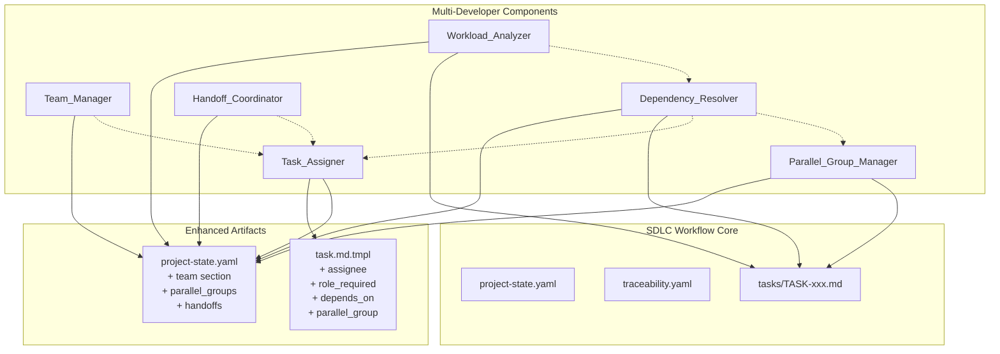
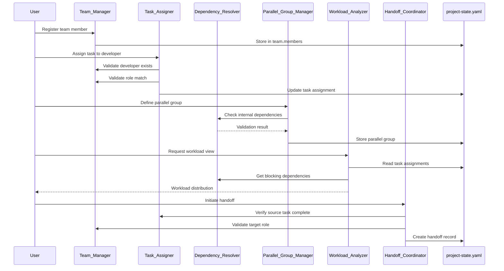
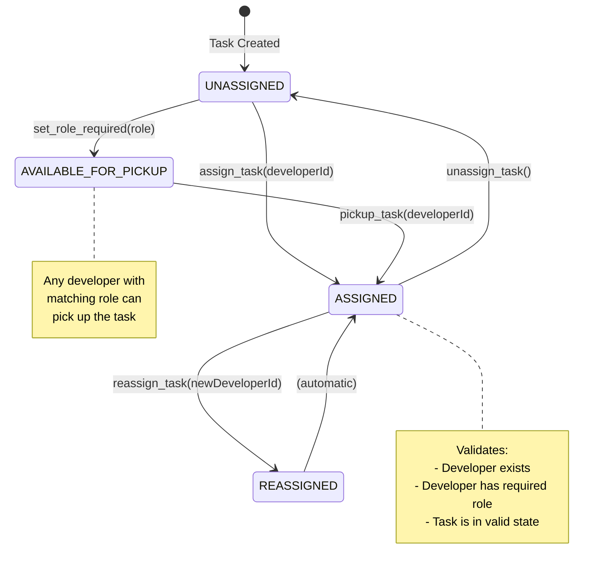
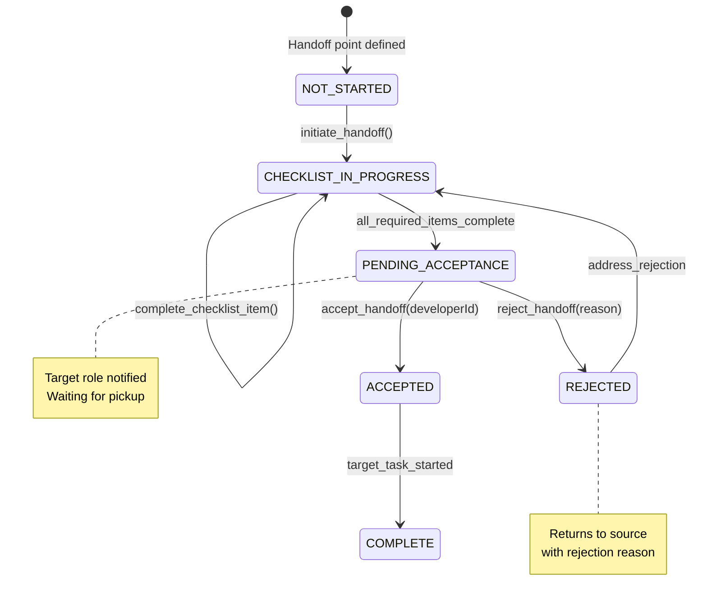
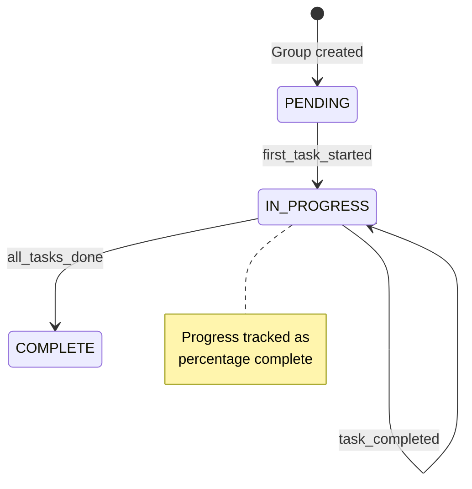
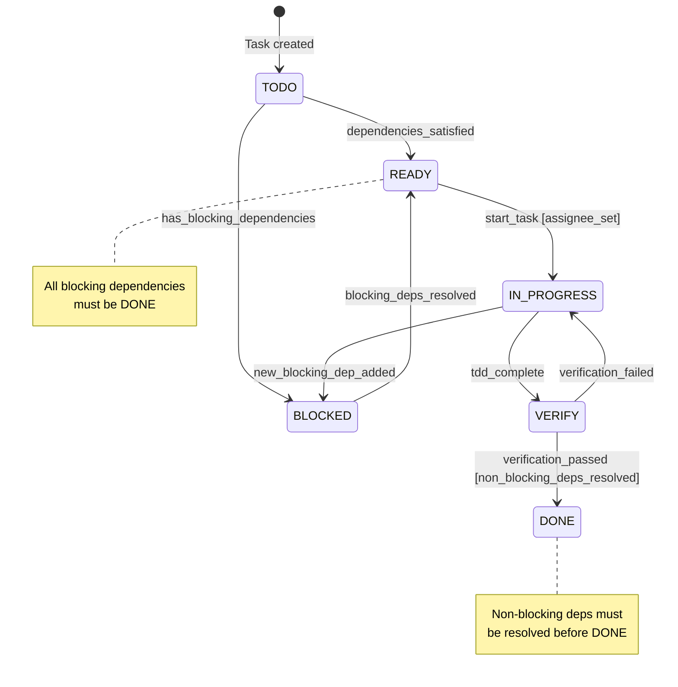

# DESIGN-001: Multi-Developer Support

## Metadata

| Field | Value |
|-------|-------|
| ID | DESIGN-001 |
| Status | DRAFT |
| Created | 2024-01-15 |
| Requirements | REQ-001 through REQ-016 |

## Overview

This design extends the SDLC Workflow Power to support multi-developer team scenarios. The current single-developer workflow is enhanced with six new components that manage team composition, task assignment, dependency resolution, workload analysis, handoff coordination, and parallel task execution.

The design maintains backward compatibility with single-developer workflows while enabling teams to work efficiently with role-based assignments, parallel task execution, cross-role dependencies, and structured handoff protocols.

### Key Design Goals

1. **Minimal Disruption**: Existing single-developer workflows continue to work unchanged
2. **Opt-in Complexity**: Team features activate only when team members are defined
3. **Traceability**: All team actions are recorded for audit and history
4. **State Consistency**: Team state integrates with existing project-state.yaml patterns
5. **TDD Compatibility**: Parallel work respects TDD cycle constraints

## Architecture

### High-Level Architecture Diagram



### Component Interaction Diagram



## Components and Interfaces

### 1. Team_Manager

Manages team member registration, role assignment, and team configuration.

#### Interface

```typescript
interface Team_Manager {
  // Team member operations
  registerMember(member: TeamMember): Result<void, TeamError>;
  removeMember(developerId: string): Result<void, TeamError>;
  updateMemberRoles(developerId: string, roles: Role[]): Result<void, TeamError>;
  
  // Query operations
  getMember(developerId: string): Result<TeamMember, TeamError>;
  listMembers(filter?: RoleFilter): TeamMember[];
  getMembersByRole(role: Role): TeamMember[];
  
  // Validation
  validateDeveloperId(developerId: string): boolean;
  validateRole(role: string): boolean;
}
```

#### Responsibilities

- Register and unregister team members
- Validate role assignments
- Prevent duplicate developer IDs
- Persist team data to project-state.yaml
- Support multi-role assignments per developer

### 2. Task_Assigner

Handles task assignment to developers based on roles and availability.

#### Interface

```typescript
interface Task_Assigner {
  // Assignment operations
  assignTask(taskId: string, developerId: string): Result<Assignment, AssignmentError>;
  unassignTask(taskId: string): Result<void, AssignmentError>;
  pickupTask(taskId: string, developerId: string): Result<Assignment, AssignmentError>;
  
  // Query operations
  getAssignment(taskId: string): Assignment | null;
  getTasksByDeveloper(developerId: string): Task[];
  getUnassignedTasks(roleFilter?: Role): Task[];
  
  // Validation
  validateAssignment(taskId: string, developerId: string): Result<void, AssignmentError>;
  
  // History
  getAssignmentHistory(taskId: string): AssignmentHistoryEntry[];
}
```

#### Responsibilities

- Validate developer has required role for task
- Enforce single-assignment rule (one developer per task)
- Record assignment timestamps
- Maintain assignment history
- Update task metadata

### 3. Dependency_Resolver

Analyzes and manages task dependencies, including cross-role dependencies.

#### Interface

```typescript
interface Dependency_Resolver {
  // Dependency operations
  addDependency(taskId: string, dependsOn: string, type: DependencyType): Result<void, DependencyError>;
  removeDependency(taskId: string, dependsOn: string): Result<void, DependencyError>;
  
  // Query operations
  getDependencies(taskId: string): Dependency[];
  getDependents(taskId: string): Task[];
  getBlockingDependencies(taskId: string): Dependency[];
  getCriticalPath(): Task[];
  
  // Validation
  detectCycles(taskId: string, dependsOn: string): CycleDetectionResult;
  canTransitionToInProgress(taskId: string): Result<void, DependencyError>;
  canTransitionToDone(taskId: string): Result<void, DependencyError>;
  
  // Visualization
  generateDependencyGraph(): MermaidDiagram;
}
```

#### Responsibilities

- Register blocking and non-blocking dependencies
- Detect circular dependencies
- Prevent invalid state transitions based on dependencies
- Generate dependency visualization
- Identify critical path tasks

### 4. Workload_Analyzer

Calculates workload distribution and identifies bottlenecks.

#### Interface

```typescript
interface Workload_Analyzer {
  // Analysis operations
  calculateWorkload(developerId: string): WorkloadSummary;
  getTeamWorkloadDistribution(): WorkloadDistribution;
  identifyBottlenecks(): Bottleneck[];
  
  // Query operations
  getTaskCountByStatus(developerId: string): StatusCounts;
  getEstimatedEffort(developerId: string): number | null;
  getTeamAverage(): number;
  
  // Recommendations
  getRebalanceRecommendations(): RebalanceRecommendation[];
}
```

#### Responsibilities

- Count tasks per developer by status
- Calculate estimated effort totals
- Identify developers with excessive workload
- Identify role-based capacity bottlenecks
- Generate recommendations for workload balancing

### 5. Handoff_Coordinator

Manages handoff points and checklists between roles.

#### Interface

```typescript
interface Handoff_Coordinator {
  // Handoff definition
  defineHandoffPoint(handoff: HandoffPointDefinition): Result<void, HandoffError>;
  updateHandoffChecklist(handoffId: string, checklist: ChecklistItem[]): Result<void, HandoffError>;
  
  // Handoff execution
  initiateHandoff(sourceTaskId: string, targetTaskId: string): Result<HandoffRecord, HandoffError>;
  acceptHandoff(handoffId: string, developerId: string): Result<void, HandoffError>;
  rejectHandoff(handoffId: string, reason: string): Result<void, HandoffError>;
  completeChecklistItem(handoffId: string, itemId: string): Result<void, HandoffError>;
  
  // Query operations
  getActiveHandoffs(): HandoffRecord[];
  getHandoffStatus(handoffId: string): HandoffStatus;
  getPendingHandoffsForRole(role: Role): HandoffRecord[];
}
```

#### Responsibilities

- Define handoff points between roles
- Enforce checklist completion before handoff
- Track handoff acceptance/rejection
- Notify target role of pending handoffs
- Record handoff history

### 6. Parallel_Group_Manager

Manages parallel task groups and tracks group progress.

#### Interface

```typescript
interface Parallel_Group_Manager {
  // Group operations
  createParallelGroup(group: ParallelGroupDefinition): Result<void, ParallelGroupError>;
  addTaskToGroup(groupId: string, taskId: string): Result<void, ParallelGroupError>;
  removeTaskFromGroup(groupId: string, taskId: string): Result<void, ParallelGroupError>;
  
  // Query operations
  getGroup(groupId: string): ParallelGroup;
  getGroupProgress(groupId: string): GroupProgress;
  getGroupsByMilestone(milestoneId: string): ParallelGroup[];
  
  // Validation
  validateGroupTasks(taskIds: string[]): Result<void, ParallelGroupError>;
  
  // Notifications
  notifyTaskCompletion(taskId: string): void;
}
```

#### Responsibilities

- Validate no internal blocking dependencies within groups
- Track completion percentage
- Associate groups with milestones
- Notify dependent tasks on completion
- Support sprint-based groupings

## Data Models

### Team Member Schema

```yaml
# In project-state.yaml under team.members[]
team:
  members:
    - id: "dev-001"                    # Unique identifier (required)
      name: "Alice Developer"          # Display name (required)
      roles:                           # List of roles (required, min 1)
        - backend
        - devops
      registered_at: "2024-01-15T10:00:00Z"
      status: ACTIVE                   # ACTIVE | INACTIVE
```

### Valid Roles

```yaml
valid_roles:
  - frontend    # UI/UX development
  - backend     # Server-side development
  - qa          # Quality assurance and testing
  - devops      # Infrastructure and deployment
  - fullstack   # Both frontend and backend
  - lead        # Technical leadership
```

### Task Assignment Schema

```yaml
# Enhanced task.md.tmpl fields
assignment:
  assignee: "dev-001"                  # Developer ID (optional)
  role_required: "backend"             # Required role (optional)
  assigned_at: "2024-01-15T10:00:00Z"
  assigned_by: "lead-001"              # Who made the assignment
  
assignment_history:
  - previous_assignee: null
    new_assignee: "dev-001"
    timestamp: "2024-01-15T10:00:00Z"
    reason: "Initial assignment"
```

### Dependency Schema

```yaml
# In task.md under depends_on
depends_on:
  - task_id: "TASK-001"
    type: blocking                     # blocking | non_blocking
    reason: "API must be complete before UI integration"
```

### Parallel Group Schema

```yaml
# In project-state.yaml under parallel_groups[]
parallel_groups:
  - id: "PG-001"
    name: "Sprint 1 - Core Features"
    milestone: "M1"
    tasks:
      - "TASK-001"
      - "TASK-002"
      - "TASK-003"
    created_at: "2024-01-15T10:00:00Z"
    status: IN_PROGRESS                # PENDING | IN_PROGRESS | COMPLETE
    progress:
      total: 3
      completed: 1
      percentage: 33
```

### Handoff Point Schema

```yaml
# In project-state.yaml under handoff_points[]
handoff_points:
  - id: "HP-001"
    name: "Backend to Frontend Handoff"
    source_role: "backend"
    target_role: "frontend"
    checklist:
      - id: "CHK-001"
        description: "API documentation updated"
        required: true
      - id: "CHK-002"
        description: "Sample request/response provided"
        required: true
      - id: "CHK-003"
        description: "Error codes documented"
        required: false
```

### Handoff Record Schema

```yaml
# In project-state.yaml under handoffs[]
handoffs:
  - id: "HO-001"
    handoff_point: "HP-001"
    source_task: "TASK-001"
    target_task: "TASK-005"
    source_developer: "dev-001"
    target_developer: "dev-002"
    status: PENDING_ACCEPTANCE         # PENDING_ACCEPTANCE | ACCEPTED | REJECTED | COMPLETE
    checklist_status:
      - item_id: "CHK-001"
        completed: true
        completed_at: "2024-01-15T12:00:00Z"
      - item_id: "CHK-002"
        completed: false
    initiated_at: "2024-01-15T11:00:00Z"
    accepted_at: null
    completed_at: null
    rejection_reason: null
```

### Enhanced project-state.yaml Schema

```yaml
# Full enhanced project-state.yaml structure
schema_version: "1"
workflow_version: "1.0.0"

lifecycle:
  phase: IMPLEMENTATION
  phase_started_at: "2024-01-15T10:00:00Z"
  last_transition_at: "2024-01-15T10:00:00Z"
  last_transition_from: PLANNING

milestone:
  id: M1
  name: "MVP Release"
  target_date: "2024-02-15"

# NEW: Team section
team:
  members:
    - id: "dev-001"
      name: "Alice Developer"
      roles: [backend, devops]
      registered_at: "2024-01-15T10:00:00Z"
      status: ACTIVE
    - id: "dev-002"
      name: "Bob Frontend"
      roles: [frontend]
      registered_at: "2024-01-15T10:00:00Z"
      status: ACTIVE
  statistics:
    total_members: 2
    by_role:
      backend: 1
      frontend: 1
      devops: 1
      qa: 0
      fullstack: 0
      lead: 0

requirements:
  total: 5
  by_status:
    DRAFT: 0
    REVIEW: 0
    APPROVED: 0
    FROZEN: 5
    SUPERSEDED: 0

tasks:
  total: 10
  by_status:
    TODO: 2
    READY: 3
    IN_PROGRESS: 2
    BLOCKED: 1
    VERIFY: 1
    DONE: 1
  # NEW: By assignee tracking
  by_assignee:
    "dev-001": 4
    "dev-002": 3
    unassigned: 3

current_task:
  id: TASK-003
  status: IN_PROGRESS
  assignee: "dev-001"
  tdd:
    phase: GREEN
    phase_started_at: "2024-01-15T14:00:00Z"
    not_applicable_reason: null

# NEW: Parallel groups section
parallel_groups:
  - id: "PG-001"
    name: "Sprint 1 - Core Features"
    milestone: "M1"
    tasks: ["TASK-001", "TASK-002", "TASK-003"]
    status: IN_PROGRESS
    progress:
      total: 3
      completed: 1
      percentage: 33

# NEW: Handoff points definition
handoff_points:
  - id: "HP-001"
    name: "Backend to Frontend Handoff"
    source_role: "backend"
    target_role: "frontend"
    checklist:
      - id: "CHK-001"
        description: "API documentation updated"
        required: true

# NEW: Active handoffs
handoffs:
  - id: "HO-001"
    handoff_point: "HP-001"
    source_task: "TASK-001"
    target_task: "TASK-005"
    source_developer: "dev-001"
    target_developer: null
    status: PENDING_ACCEPTANCE
    initiated_at: "2024-01-15T11:00:00Z"

blockers:
  count: 1
  ids: ["BLOCKER-001"]

changes:
  pending: 0
  ids: []

release:
  status: NOT_STARTED
  version: null

last_action:
  action: "Task TASK-001 completed, handoff initiated"
  timestamp: "2024-01-15T15:00:00Z"
  result: SUCCESS
  details: "Handoff HO-001 created for backend-to-frontend transition"

next_permitted_actions:
  - continue_tdd
  - accept_handoff
  - view_workload

validation:
  last_validated_at: "2024-01-15T15:00:00Z"
  validation_result: VALID
  issues: null
```

### Enhanced task.md.tmpl Schema

```yaml
# Enhanced task template fields
metadata:
  id: "TASK-001"
  title: "Implement User Authentication API"
  status: IN_PROGRESS
  risk: MEDIUM
  created: "2024-01-15T10:00:00Z"
  requirement: "REQ-001"
  design: "DESIGN-001"
  
# NEW: Assignment fields
assignment:
  assignee: "dev-001"                  # Developer ID
  role_required: "backend"             # Required role
  assigned_at: "2024-01-15T11:00:00Z"
  assigned_by: "lead-001"

# NEW: Dependencies with types
depends_on:
  - task_id: "TASK-000"
    type: "blocking"
  - task_id: "TASK-002"
    type: "non_blocking"

# NEW: Parallel group association
parallel_group: "PG-001"

# NEW: Assignment history
assignment_history:
  - previous_assignee: null
    new_assignee: "dev-001"
    timestamp: "2024-01-15T11:00:00Z"
    reason: "Initial assignment during planning"

# Existing fields continue...
acceptance_criteria: []
description: ""
expected_files: []
test_requirements: []
implementation_notes: ""
tdd_status: {}
definition_of_done: []
```

## State Transitions

### Assignment State Machine



### Handoff State Machine



### Parallel Group State Machine



### Dependency-Aware Task State Transitions



## Error Handling

### Error Categories

| Category | Code Range | Description |
|----------|------------|-------------|
| TEAM_ERROR | 1000-1099 | Team management errors |
| ASSIGNMENT_ERROR | 1100-1199 | Task assignment errors |
| DEPENDENCY_ERROR | 1200-1299 | Dependency resolution errors |
| WORKLOAD_ERROR | 1300-1399 | Workload analysis errors |
| HANDOFF_ERROR | 1400-1499 | Handoff coordination errors |
| PARALLEL_GROUP_ERROR | 1500-1599 | Parallel group errors |

### Error Definitions

```typescript
// Team Errors
TEAM_MEMBER_NOT_FOUND = 1001       // Developer ID not registered
DUPLICATE_MEMBER_ID = 1002         // ID already exists
INVALID_ROLE = 1003                // Role not in valid_roles list
MEMBER_HAS_ACTIVE_TASKS = 1004     // Cannot remove member with tasks

// Assignment Errors
DEVELOPER_NOT_FOUND = 1101         // Assignee ID not registered
ROLE_MISMATCH = 1102               // Developer lacks required role
TASK_ALREADY_ASSIGNED = 1103       // Task has existing assignee
TASK_NOT_ASSIGNABLE = 1104         // Task in invalid state for assignment
INVALID_ROLE_REQUIRED = 1105       // role_required value invalid

// Dependency Errors
CIRCULAR_DEPENDENCY = 1201         // Cycle detected in dependency graph
DEPENDENCY_NOT_FOUND = 1202        // Referenced task doesn't exist
INVALID_DEPENDENCY_TYPE = 1203     // Type not blocking/non_blocking
SELF_DEPENDENCY = 1204             // Task depends on itself
BLOCKING_DEP_UNSATISFIED = 1205    // Cannot start due to blocking dep
NON_BLOCKING_DEP_UNSATISFIED = 1206 // Cannot complete due to non-blocking dep

// Handoff Errors
HANDOFF_POINT_NOT_FOUND = 1401     // Handoff point ID invalid
CHECKLIST_INCOMPLETE = 1402        // Required items not complete
SOURCE_TASK_NOT_COMPLETE = 1403    // Source task not DONE
TARGET_ROLE_INVALID = 1404         // Target developer wrong role
HANDOFF_ALREADY_ACCEPTED = 1405    // Cannot modify accepted handoff
HANDOFF_ALREADY_REJECTED = 1406    // Handoff in rejected state

// Parallel Group Errors
INTERNAL_DEPENDENCY_CONFLICT = 1501 // Tasks in group have blocking deps
GROUP_NOT_FOUND = 1502             // Group ID invalid
TASK_ALREADY_IN_GROUP = 1503       // Task belongs to another group
INVALID_MILESTONE_REF = 1504       // Milestone doesn't exist
```

### Error Response Format

```yaml
error:
  code: 1102
  category: ASSIGNMENT_ERROR
  message: "Developer dev-003 does not have required role 'backend'"
  context:
    task_id: "TASK-005"
    developer_id: "dev-003"
    required_role: "backend"
    developer_roles: ["frontend", "qa"]
  suggested_action: "Assign to a developer with 'backend' role or update developer roles"
  timestamp: "2024-01-15T15:00:00Z"
```

## Correctness Properties

*A property is a characteristic or behavior that should hold true across all valid executions of a system-essentially, a formal statement about what the system should do. Properties serve as the bridge between human-readable specifications and machine-verifiable correctness guarantees.*

### Property 1: Team Member Registration Uniqueness

*For any* set of team member registrations, the Team_Manager SHALL ensure that no two members have the same id, and attempting to register a duplicate id SHALL result in rejection.

**Validates: Requirements 1.5**

### Property 2: Role Validation Consistency

*For any* role string provided to any component, the validation result SHALL be consistent: if Team_Manager.validateRole(role) returns true, then all other components SHALL accept that role, and vice versa.

**Validates: Requirements 1.2, 1.3, 4.2**

### Property 3: Assignment Role Constraint

*For any* task with a role_required field and an assignee field, the assignee's roles SHALL include the role_required value, or the assignment SHALL be rejected.

**Validates: Requirements 3.3, 3.4**

### Property 4: Dependency Cycle Detection

*For any* dependency graph, adding a dependency from task A to task B SHALL be rejected if and only if there exists a path from B to A in the current graph (forming a cycle).

**Validates: Requirements 7.5**

### Property 5: Blocking Dependency State Constraint

*For any* task with blocking dependencies, the task SHALL NOT transition to IN_PROGRESS status while any blocking dependency task is not in DONE status.

**Validates: Requirements 7.3**

### Property 6: Non-Blocking Dependency Completion Constraint

*For any* task with non-blocking dependencies, the task SHALL NOT transition to DONE status while any non-blocking dependency task is not in DONE status.

**Validates: Requirements 7.4**

### Property 7: Parallel Group Internal Dependency Constraint

*For any* parallel group definition, if any task in the group has a blocking dependency on another task in the same group, the group creation SHALL be rejected.

**Validates: Requirements 5.2, 5.3**

### Property 8: Handoff Checklist Completion Gate

*For any* handoff, the handoff SHALL NOT transition to COMPLETE status until all required checklist items are marked as complete.

**Validates: Requirements 11.4**

### Property 9: Workload Calculation Consistency

*For any* developer, the sum of tasks returned by getTasksByDeveloper(developerId) grouped by status SHALL equal the counts in getTaskCountByStatus(developerId).

**Validates: Requirements 9.1**

### Property 10: Parallel Group Progress Accuracy

*For any* parallel group, the progress percentage SHALL equal (completed_tasks / total_tasks) * 100, and a group SHALL be marked COMPLETE if and only if all tasks are DONE.

**Validates: Requirements 6.1, 6.3**

### Property 11: Assignment History Completeness

*For any* task that has undergone assignment changes, the assignment_history SHALL contain an entry for each change with correct previous_assignee, new_assignee, and timestamp values.

**Validates: Requirements 16.1, 16.2**

### Property 12: Bottleneck Detection Threshold

*For any* developer, the Workload_Analyzer SHALL identify them as a bottleneck if and only if they have more than 3 tasks in IN_PROGRESS or BLOCKED status combined.

**Validates: Requirements 10.1**

## Testing Strategy

### Unit Tests

Unit tests focus on individual component logic:

1. **Team_Manager Tests**
   - Registration with valid/invalid data
   - Duplicate ID rejection
   - Role validation
   - Multi-role assignment

2. **Task_Assigner Tests**
   - Valid assignment scenarios
   - Role mismatch rejection
   - Assignment history recording
   - Unassigned task pickup

3. **Dependency_Resolver Tests**
   - Cycle detection algorithms
   - Blocking/non-blocking behavior
   - Critical path calculation

4. **Workload_Analyzer Tests**
   - Task counting accuracy
   - Bottleneck threshold detection
   - Average calculation

5. **Handoff_Coordinator Tests**
   - Checklist state management
   - Acceptance/rejection flows
   - Notification triggers

6. **Parallel_Group_Manager Tests**
   - Internal dependency validation
   - Progress calculation
   - Completion detection

### Property-Based Tests

Property tests verify universal properties across randomized inputs:

1. **Uniqueness Properties**
   - Generate random team member registrations, verify no duplicates accepted

2. **Role Validation Properties**
   - Generate random role strings, verify consistent validation across components

3. **Dependency Graph Properties**
   - Generate random task graphs, verify cycle detection correctness
   - Generate random state transitions, verify dependency constraints enforced

4. **Calculation Properties**
   - Generate random task distributions, verify workload calculations
   - Generate random group compositions, verify progress accuracy

### Integration Tests

Integration tests verify component interactions:

1. **End-to-End Assignment Flow**
   - Register team → Create task → Assign → Verify state

2. **Dependency-Aware TDD Flow**
   - Create dependent tasks → Verify blocking → Complete dependency → Verify unblocking

3. **Complete Handoff Flow**
   - Define handoff point → Complete source task → Initiate handoff → Complete checklist → Accept → Start target task

4. **Parallel Execution Flow**
   - Create parallel group → Multiple developers work simultaneously → Verify progress tracking

### Test Configuration

- Property tests: minimum 100 iterations per property
- Each property test references its design document property
- Tag format: **Feature: multi-developer-support, Property {number}: {property_text}**

## Migration Strategy

### Phase 1: Schema Enhancement (Non-Breaking)

1. Add new optional sections to project-state.yaml template:
   - `team` section with empty `members` array
   - `parallel_groups` section as empty array
   - `handoffs` section as empty array
   - `handoff_points` section as empty array

2. Add new optional fields to task.md.tmpl:
   - `assignee` (default: null)
   - `role_required` (default: null)
   - `depends_on` (default: empty array)
   - `parallel_group` (default: null)
   - `assignment_history` (default: empty array)

3. Existing single-developer projects continue to work unchanged

### Phase 2: Component Implementation

1. Implement Team_Manager with full validation
2. Implement Task_Assigner with backward compatibility check
3. Implement Dependency_Resolver
4. Implement Workload_Analyzer
5. Implement Handoff_Coordinator
6. Implement Parallel_Group_Manager

### Phase 3: Steering File Updates

1. Create new `11-team.md` steering file for team management commands
2. Update `05-planning.md` with multi-developer task generation
3. Update `06-implementation.md` with parallel TDD coordination

### Phase 4: Validation

1. Add team validation rules to `validate.md`
2. Update `status.md` with team-aware status reporting
3. Update `resume.md` with team context recovery

## Rollback Strategy

### Immediate Rollback

If issues discovered post-deployment:

1. Revert steering file changes to previous versions
2. New team-related fields in YAML remain but are ignored
3. Single-developer workflows continue unaffected

### Data Preservation

Team data persists in project-state.yaml even after rollback:
- Does not affect core workflow
- Can be migrated forward when fix is deployed

### Feature Flag Option

Consider implementing feature flag in `.config.yaml`:

```yaml
settings:
  multi_developer_enabled: false  # Toggle team features
```

## Open Questions

- [x] Should we support team member "status" (ACTIVE/INACTIVE) for temporary unavailability? **Decision: Yes, included in design**
- [ ] Should handoff notifications integrate with external systems (Slack, email)? **Deferred to future enhancement**
- [ ] Should workload estimates use story points or time-based estimates? **Deferred to implementation**
- [ ] Should parallel groups support maximum concurrent tasks limit? **Deferred to future enhancement**

## ADR References

- ADR-001: Multi-Developer Architecture Approach (to be created during implementation)
- ADR-002: Dependency Resolution Algorithm (to be created during implementation)

## Task References

- (To be added after planning phase)
