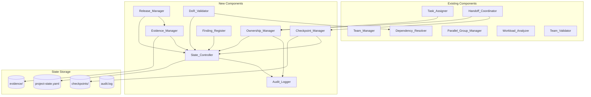
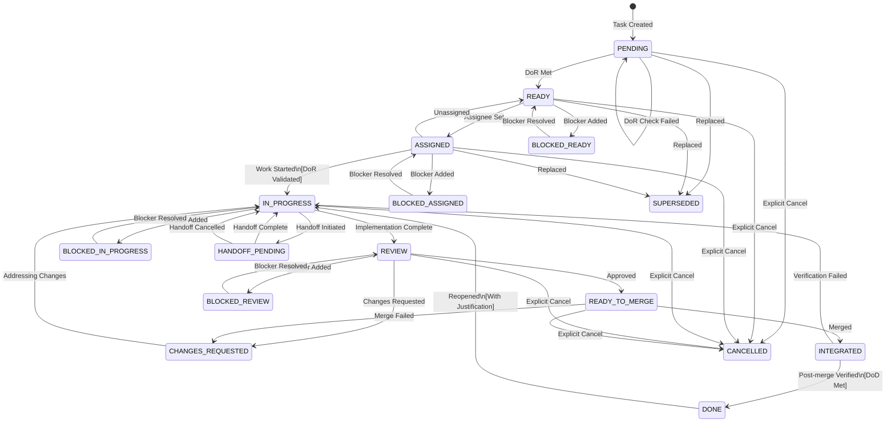
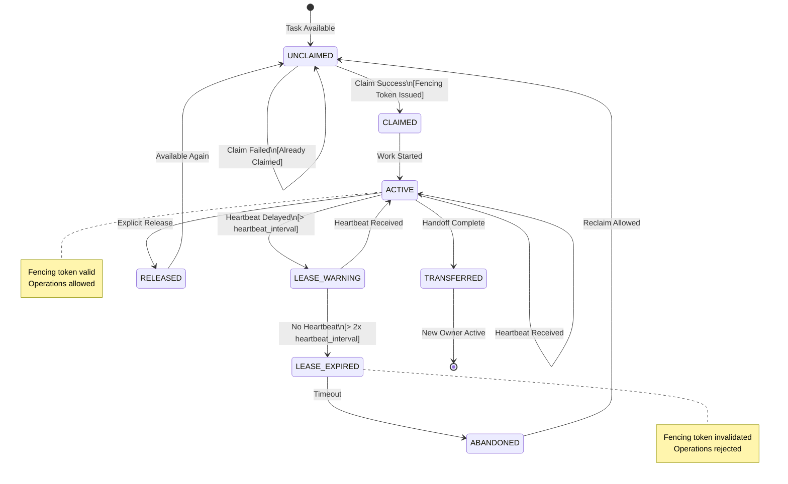
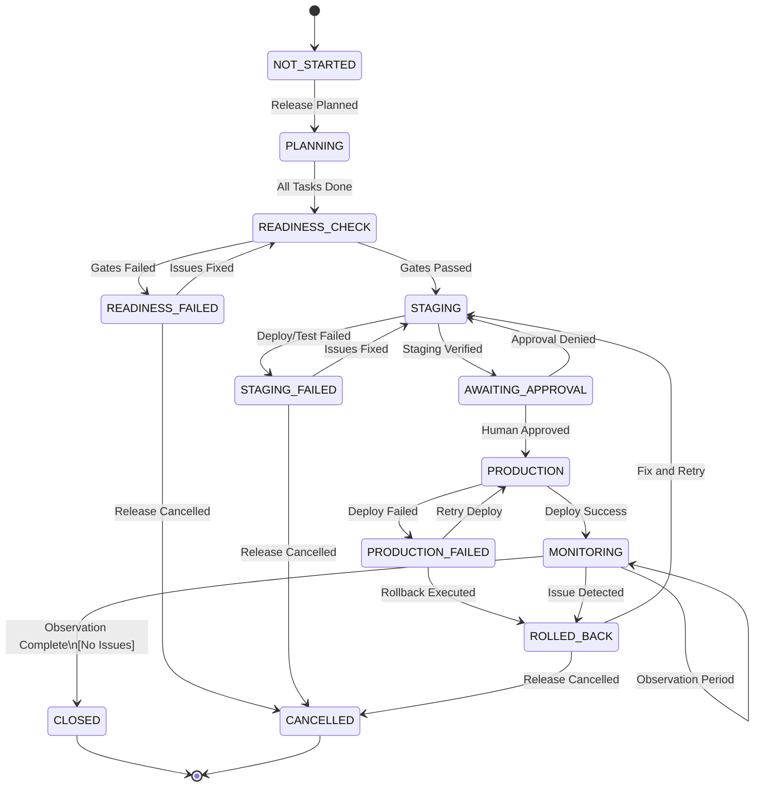
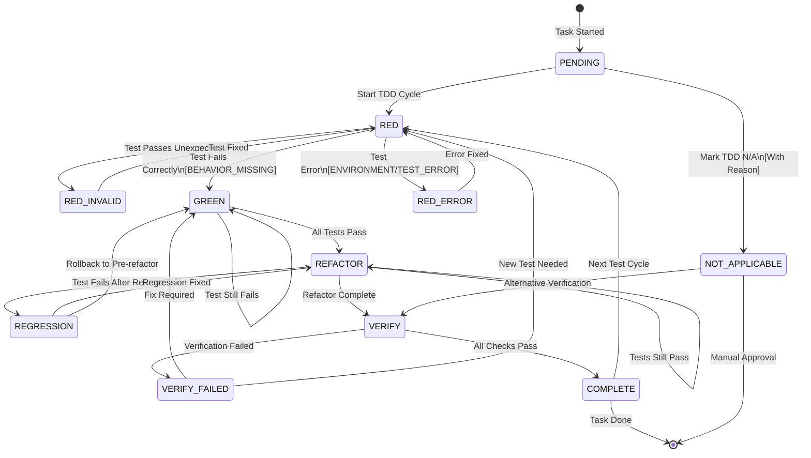

# DESIGN: SDLC Workflow Reliability

## Metadata

| Field | Value |
|-------|-------|
| ID | DESIGN-RELIABILITY-001 |
| Status | DRAFT |
| Created | 2026-10-12 |
| Requirements | R01 through R17 |
| Builds On | Multi-Developer Support (DESIGN-001) |

## Overview

Desain ini menambahkan reliability, concurrency control, dan release lifecycle ke SDLC Workflow Power. Desain ini mempertahankan backward compatibility dengan komponen multi-developer yang sudah diimplementasikan.

### Design Goals

1. **Backward Compatibility**: Existing project-state.yaml dan workflows tetap berfungsi
2. **Incremental Adoption**: Fitur baru dapat diadopsi secara bertahap
3. **No External Dependencies**: Core functionality tidak memerlukan external services
4. **Auditability**: Semua perubahan penting ter-log
5. **Recoverability**: State dapat di-recover setelah crash

### Scope Boundaries

| In Scope | Out of Scope |
|----------|--------------|
| File-based state management | Distributed lock service |
| Single-machine concurrency | Multi-machine coordination |
| Git-based isolation | External CI/CD automation |
| Local audit logging | External notification services |
| Human dan AI agent policies | OAuth/authentication |

---

## Architecture

### Component Overview



### Component Responsibilities

| Component | Responsibility | Requirements |
|-----------|---------------|--------------|
| State_Controller | Atomic state read/write dengan versioning | R02, R16 |
| Ownership_Manager | Task ownership, lease, fencing | R02, R12 |
| Checkpoint_Manager | Create/restore checkpoints | R09 |
| Evidence_Manager | Evidence lifecycle, staleness detection | R05, R06 |
| Release_Manager | Release lifecycle management | R15 |
| Audit_Logger | Audit log writing | R16 |
| DoR_Validator | Definition of Ready validation | R01 |
| Finding_Register | Review findings management | R11 |

---

## Data Models

### Enhanced project-state.yaml Schema

```yaml
# Existing fields preserved...
schema_version: "2"  # Incremented for new features
workflow_version: "1.1.0"

# NEW: State versioning for optimistic concurrency
state_version: 1
last_modified_at: "2026-10-12T10:00:00Z"
last_modified_by: "dev-001"

lifecycle:
  phase: IMPLEMENTATION
  phase_started_at: "2026-10-12T10:00:00Z"
  
# Existing team section...
team:
  members: [...]
  statistics: {...}

# Enhanced task section
tasks:
  total: 10
  by_status: {...}
  by_assignee: {...}

# Enhanced current_task
current_task:
  id: TASK-003
  status: IN_PROGRESS
  assignee: "dev-001"
  # NEW: Ownership details
  ownership:
    fencing_token: "550e8400-e29b-41d4-a716-446655440000"
    acquired_at: "2026-10-12T10:00:00Z"
    actor_type: HUMAN  # or AI_AGENT
    lease_expires_at: null  # null for HUMAN, timestamp for AI_AGENT
    last_heartbeat_at: null  # only for AI_AGENT
  # NEW: DoR validation result
  dor_check:
    passed: true
    checked_at: "2026-10-12T10:00:00Z"
    conditions:
      - condition: "acceptance_criteria_defined"
        passed: true
      - condition: "blocking_dependencies_done"
        passed: true
      - condition: "required_decisions_resolved"
        passed: true
      - condition: "assignee_has_role"
        passed: true
  tdd:
    phase: GREEN
    phase_started_at: "2026-10-12T10:30:00Z"
    not_applicable_reason: null
  # NEW: Blocked as orthogonal attribute
  blocked: false
  blocked_reason: null
  blocker_refs: []
  # NEW: Handoff pending as orthogonal attribute
  handoff_pending: false
  handoff_id: null
  # NEW: Working branch
  working_branch: "task/TASK-003-user-auth"

# Existing parallel_groups, handoff_points, handoffs...

# NEW: Resource locks
resource_locks:
  - resource_id: "db-migration-slot"
    held_by_task: "TASK-003"
    held_by_owner: "dev-001"
    acquired_at: "2026-10-12T10:00:00Z"
    expires_at: "2026-10-12T14:00:00Z"  # 4 hour max

# NEW: Active checkpoints summary
checkpoints:
  last_checkpoint_id: "CP-2026-10-12-001"
  last_checkpoint_at: "2026-10-12T10:30:00Z"
  checkpoint_count: 15

# NEW: Findings register summary
findings:
  total: 5
  by_status:
    OPEN: 2
    RESOLVED: 3
  by_severity:
    CRITICAL: 0
    HIGH: 1
    MEDIUM: 2
    LOW: 2
  blocking_release: 1

# NEW: Release tracking
release:
  status: NOT_STARTED  # or PLANNING, READINESS_CHECK, STAGING, PRODUCTION, etc.
  version: null
  current_stage: null
  stages:
    readiness_check:
      status: NOT_STARTED
      completed_at: null
      evidence_id: null
    staging:
      status: NOT_STARTED
      deployed_at: null
      verified_at: null
      evidence_id: null
    production:
      status: NOT_STARTED
      approved_by: null
      approved_at: null
      deployed_at: null
      verified_at: null
      evidence_id: null
  rollback_available: false
  previous_version: null

# NEW: Actor configuration
actor_config:
  lease_duration_seconds: 3600
  heartbeat_interval_seconds: 300
  inactivity_warning_seconds: 7200
  handoff_timeout_hours: 24

# NEW: Quality gates configuration
quality_gates:
  unit_test:
    required: true
    min_pass_rate: 100
  integration_test:
    required: true
    min_pass_rate: 100
  lint:
    required: true
  type_check:
    required: true
  security_scan:
    required_for_risk: [HIGH, CRITICAL]

# Existing last_action, next_permitted_actions, validation...
```

### Task File Enhanced Schema (TASK-xxx.md)

```yaml
# Existing metadata...
metadata:
  id: "TASK-003"
  title: "Implement User Authentication"
  status: IN_PROGRESS
  risk: MEDIUM
  created: "2026-10-12T09:00:00Z"
  requirement: "REQ-001"
  design: "DESIGN-001"

# Existing assignment...
assignment:
  assignee: "dev-001"
  role_required: "backend"
  assigned_at: "2026-10-12T09:30:00Z"
  assigned_by: "lead-001"

# NEW: Enhanced ownership tracking
ownership:
  fencing_token: "550e8400-e29b-41d4-a716-446655440000"
  acquired_at: "2026-10-12T10:00:00Z"
  actor_type: HUMAN
  lease_config:
    duration_seconds: null  # null = no lease for HUMAN
    heartbeat_interval_seconds: null
  last_heartbeat_at: null
  lease_history:
    - token: "previous-token-uuid"
      owner: "dev-002"
      acquired_at: "2026-10-12T08:00:00Z"
      released_at: "2026-10-12T09:30:00Z"
      release_reason: "handoff"

# NEW: Definition of Ready tracking
definition_of_ready:
  passed: true
  last_checked_at: "2026-10-12T10:00:00Z"
  conditions:
    - id: "dor-ac-defined"
      description: "Acceptance criteria defined"
      passed: true
      details: "3 acceptance criteria present"
    - id: "dor-deps-done"
      description: "Blocking dependencies complete"
      passed: true
      details: "TASK-001, TASK-002 are DONE"
    - id: "dor-decisions-resolved"
      description: "Required decisions made"
      passed: true
      details: "DEC-001 resolved"
    - id: "dor-role-match"
      description: "Assignee has required role"
      passed: true
      details: "dev-001 has 'backend' role"

# NEW: Blocked as orthogonal state
blocked_status:
  blocked: false
  reason: null
  blocker_refs: []
  blocked_since: null
  blocked_phase: null  # Which phase was blocked (e.g., "IN_PROGRESS")

# Existing depends_on...
depends_on:
  - task_id: "TASK-001"
    type: "blocking"
    reason: "API must be complete"
    satisfied: true
    satisfied_at: "2026-10-12T09:00:00Z"

# NEW: Working branch info
isolation:
  working_branch: "task/TASK-003-user-auth"
  base_branch: "main"
  base_commit: "abc123def456"
  potential_conflicts: []

# Existing TDD status...
tdd_status:
  applicable: true
  exemption_reason: null
  verification_method: "automated_tests"
  phase: GREEN
  phases:
    RED:
      status: COMPLETE
      evidence_id: "EVD-TASK-003-RED"
      completed_at: "2026-10-12T10:15:00Z"
    GREEN:
      status: IN_PROGRESS
      evidence_id: null
      started_at: "2026-10-12T10:20:00Z"
    REFACTOR:
      status: NOT_STARTED
    VERIFY:
      status: NOT_STARTED

# Existing definition_of_done...
```

### Checkpoint Schema

```yaml
# File: .kiro/sdlc/checkpoints/CP-2026-10-12-001.yaml
checkpoint_id: "CP-2026-10-12-001"
created_at: "2026-10-12T10:30:00Z"
created_by: "dev-001"
trigger: "tdd_phase_transition"  # or "manual", "periodic", "state_transition"
note: null  # Optional user note

# Snapshot data
snapshot:
  state_version: 42
  task_id: "TASK-003"
  task_status: IN_PROGRESS
  owner_id: "dev-001"
  fencing_token: "550e8400-e29b-41d4-a716-446655440000"
  tdd_phase: GREEN
  
  # Git state
  branch_name: "task/TASK-003-user-auth"
  commit_sha: "abc123def456"
  uncommitted_changes:
    - path: "src/auth.ts"
      type: "modified"
    - path: "src/auth.test.ts"
      type: "modified"
  
  # Evidence collected
  evidence_refs:
    - "EVD-TASK-003-RED"
  
  # Blockers
  blockers: []
  
  # Recommended next action
  next_action: "Continue GREEN phase: implement minimum code to pass test"

# Validation info
validation:
  valid_at_creation: true
  repository_hash: "sha256:..."  # Hash of key repo state
```

### Evidence Schema

```yaml
# File: .kiro/sdlc/evidence/EVD-TASK-003-RED.yaml
evidence_id: "EVD-TASK-003-RED"
created_at: "2026-10-12T10:15:00Z"

# What was verified
task_id: "TASK-003"
tdd_phase: RED
requirement_refs:
  - "REQ-001"
ac_refs:
  - "REQ-001-AC1"
  - "REQ-001-AC2"

# Git state at verification
git_state:
  commit_sha: "abc123def456"
  branch: "task/TASK-003-user-auth"
  working_tree_dirty: false
  uncommitted_files: []

# Execution details
execution:
  command: "npm test -- --grep 'user authentication'"
  working_directory: "/project"
  config:
    test_framework: "vitest"
    config_file: "vitest.config.ts"
  environment:
    node_version: "20.10.0"
    os: "linux"
  timestamp: "2026-10-12T10:15:00Z"
  duration_ms: 1250
  exit_code: 1  # Non-zero = test failed (expected for RED)

# Result
result:
  status: PASS  # RED phase expects failure, so test failing = PASS for RED
  summary: "Test correctly fails: 'should authenticate valid user' - AssertionError: expected undefined to equal true"
  test_file: "src/auth.test.ts"
  test_name: "user authentication > should authenticate valid user"
  failure_type: "BEHAVIOR_MISSING"  # Correct type for RED phase
  log_path: ".kiro/sdlc/evidence/logs/EVD-TASK-003-RED.log"

# Executor info
executor:
  id: "dev-001"
  type: HUMAN  # or AI_AGENT

# Staleness tracking
staleness:
  stale: false
  stale_reason: null
  checked_at: "2026-10-12T10:15:00Z"
  related_files:
    - path: "src/auth.ts"
      hash_at_verification: "sha256:abc..."
    - path: "src/auth.test.ts"
      hash_at_verification: "sha256:def..."
```

### Finding Schema

```yaml
# File: .kiro/sdlc/findings/FND-001.yaml
finding_id: "FND-001"
created_at: "2026-10-12T14:00:00Z"

task_id: "TASK-003"
review_round: 1

severity: HIGH  # CRITICAL, HIGH, MEDIUM, LOW, INFO
category: SECURITY  # BUG, SECURITY, PERFORMANCE, STYLE, DOCUMENTATION, OTHER

scope:
  type: "file_location"  # or "general"
  file: "src/auth.ts"
  line_start: 45
  line_end: 52

description: "Password comparison uses timing-unsafe string equality"
evidence: "Code review identified `password === stored` instead of constant-time comparison"

acceptance_criteria: |
  Use crypto.timingSafeEqual or equivalent for password comparison
  to prevent timing attacks.

owner_id: "dev-001"

status: OPEN  # OPEN, IN_PROGRESS, RESOLVED, WONT_FIX, DUPLICATE

resolution:
  resolution_evidence: null  # Will be filled when resolved
  resolved_at: null
  resolved_by: null
  commit_sha: null

history:
  - action: "created"
    timestamp: "2026-10-12T14:00:00Z"
    by: "reviewer-001"
```

### Audit Log Entry Schema

```yaml
# File: .kiro/sdlc/audit.log (JSONL format, one entry per line)
{
  "operation_id": "op-550e8400-e29b-41d4-a716-446655440000",
  "correlation_id": "corr-123456",
  "timestamp": "2026-10-12T10:00:00.000Z",
  "actor_id": "dev-001",
  "actor_type": "HUMAN",
  "action": "TASK_STATUS_CHANGE",
  "resource_type": "Task",
  "resource_id": "TASK-003",
  "state_version_before": 41,
  "state_version_after": 42,
  "changes": {
    "status": {"from": "ASSIGNED", "to": "IN_PROGRESS"},
    "tdd.phase": {"from": null, "to": "PENDING"}
  },
  "reason": "Developer started work on task",
  "outcome": "SUCCESS",
  "error_details": null
}
```

---

## State Machines

### Task State Machine



### Ownership State Machine (untuk AI Agent)



### Release State Machine



### TDD Phase Machine (Enhanced)



---

## Component Interfaces

### State_Controller

```typescript
interface StateController {
  /**
   * Reads current state with version.
   * Returns state and its version for optimistic concurrency.
   */
  readState(): Promise<{ state: ProjectState; version: number }>;
  
  /**
   * Writes state with version check.
   * Fails if expectedVersion doesn't match current version.
   * @throws StateVersionConflictError if version mismatch
   */
  writeState(
    state: ProjectState, 
    expectedVersion: number,
    operationId: string,
    reason: string
  ): Promise<{ newVersion: number }>;
  
  /**
   * Atomic read-modify-write operation.
   * Handles retry on version conflict internally.
   */
  updateState(
    modifier: (state: ProjectState) => ProjectState,
    operationId: string,
    reason: string,
    maxRetries?: number
  ): Promise<{ state: ProjectState; version: number }>;
  
  /**
   * Validates state consistency.
   */
  validateConsistency(): Promise<ValidationResult>;
}
```

### Ownership_Manager

```typescript
interface OwnershipManager {
  /**
   * Claims ownership of a task.
   * Generates fencing token and records ownership.
   * @throws TaskAlreadyClaimedError if task has active owner
   */
  claimTask(
    taskId: string, 
    ownerId: string, 
    actorType: ActorType
  ): Promise<{ fencingToken: string; lease?: LeaseInfo }>;
  
  /**
   * Releases ownership explicitly.
   * Invalidates fencing token.
   */
  releaseTask(taskId: string, fencingToken: string): Promise<void>;
  
  /**
   * Validates fencing token for operation.
   * @throws InvalidFencingTokenError if token invalid/expired
   */
  validateFencingToken(taskId: string, fencingToken: string): Promise<boolean>;
  
  /**
   * Records heartbeat for AI agent.
   * Extends lease if close to expiry.
   */
  recordHeartbeat(taskId: string, fencingToken: string): Promise<{ leaseExtended: boolean }>;
  
  /**
   * Checks and handles expired leases.
   * Called periodically by system.
   */
  checkExpiredLeases(): Promise<{ expiredTasks: string[] }>;
  
  /**
   * Transfers ownership atomically.
   * Used during handoff.
   */
  transferOwnership(
    taskId: string,
    fromFencingToken: string,
    toOwnerId: string,
    toActorType: ActorType
  ): Promise<{ newFencingToken: string }>;
}

interface LeaseInfo {
  expiresAt: string;
  heartbeatInterval: number;
}

type ActorType = 'HUMAN' | 'AI_AGENT';
```

### Checkpoint_Manager

```typescript
interface CheckpointManager {
  /**
   * Creates a checkpoint of current state.
   */
  createCheckpoint(
    trigger: CheckpointTrigger,
    taskId?: string,
    note?: string
  ): Promise<Checkpoint>;
  
  /**
   * Lists checkpoints for a task.
   */
  listCheckpoints(taskId: string): Promise<Checkpoint[]>;
  
  /**
   * Gets latest checkpoint for a task/owner.
   */
  getLatestCheckpoint(taskId: string, ownerId?: string): Promise<Checkpoint | null>;
  
  /**
   * Validates checkpoint against current repository state.
   */
  validateCheckpoint(checkpointId: string): Promise<CheckpointValidation>;
  
  /**
   * Prepares recovery plan from checkpoint.
   */
  prepareRecovery(checkpointId: string): Promise<RecoveryPlan>;
  
  /**
   * Executes recovery with user confirmation.
   */
  executeRecovery(
    recoveryPlan: RecoveryPlan,
    userConfirmation: boolean
  ): Promise<RecoveryResult>;
  
  /**
   * Prunes old checkpoints based on retention policy.
   */
  pruneCheckpoints(taskId: string, keepCount: number): Promise<number>;
}

type CheckpointTrigger = 
  | 'state_transition'
  | 'tdd_phase_transition'
  | 'evidence_created'
  | 'handoff'
  | 'manual'
  | 'periodic';

interface RecoveryPlan {
  checkpointId: string;
  discrepancies: Discrepancy[];
  strategy: 'AUTO_MERGE' | 'PROMPT_USER' | 'REJECT';
  proposedActions: RecoveryAction[];
}
```

### Evidence_Manager

```typescript
interface EvidenceManager {
  /**
   * Creates evidence record.
   */
  createEvidence(evidence: EvidenceInput): Promise<Evidence>;
  
  /**
   * Gets evidence by ID.
   */
  getEvidence(evidenceId: string): Promise<Evidence | null>;
  
  /**
   * Lists evidence for a task.
   */
  listEvidenceForTask(taskId: string): Promise<Evidence[]>;
  
  /**
   * Checks if evidence is stale.
   * Compares commit SHA and file hashes.
   */
  checkStaleness(evidenceId: string): Promise<StalenessCheck>;
  
  /**
   * Marks evidence as stale with reason.
   */
  markStale(evidenceId: string, reason: string): Promise<void>;
  
  /**
   * Validates evidence for quality gate.
   */
  validateForGate(
    taskId: string,
    gate: QualityGate
  ): Promise<GateValidation>;
  
  /**
   * Gets all stale evidence for a release.
   */
  getStaleEvidenceForRelease(releaseId: string): Promise<Evidence[]>;
}

interface EvidenceInput {
  taskId: string;
  tddPhase?: TddPhase;
  requirementRefs: string[];
  acRefs: string[];
  command: string;
  result: EvidenceResult;
  executorId: string;
  executorType: ActorType;
}
```

### DoR_Validator

```typescript
interface DoRValidator {
  /**
   * Validates Definition of Ready for a task.
   */
  validateDoR(taskId: string): Promise<DoRValidation>;
  
  /**
   * Re-validates DoR when conditions change.
   * Called when dependencies complete, blockers resolve, etc.
   */
  revalidateAffectedTasks(changedTaskId: string): Promise<RevalidationResult>;
  
  /**
   * Gets DoR conditions for a task.
   */
  getDoRConditions(taskId: string): Promise<DoRCondition[]>;
  
  /**
   * Checks if task can transition to IN_PROGRESS.
   */
  canStartWork(taskId: string): Promise<{ allowed: boolean; blockers: string[] }>;
}

interface DoRCondition {
  id: string;
  description: string;
  type: 'acceptance_criteria' | 'dependencies' | 'decisions' | 'role_match' | 'no_blockers';
  passed: boolean;
  details: string;
}
```

### Finding_Register

```typescript
interface FindingRegister {
  /**
   * Creates a new finding.
   */
  createFinding(finding: FindingInput): Promise<Finding>;
  
  /**
   * Updates finding status.
   */
  updateFindingStatus(
    findingId: string,
    status: FindingStatus,
    resolution?: ResolutionInfo
  ): Promise<Finding>;
  
  /**
   * Gets findings for a task.
   */
  getFindingsForTask(taskId: string): Promise<Finding[]>;
  
  /**
   * Gets open blocking findings.
   */
  getBlockingFindings(taskId: string): Promise<Finding[]>;
  
  /**
   * Checks if review can be closed.
   */
  canCloseReview(taskId: string): Promise<{ canClose: boolean; blockers: Finding[] }>;
  
  /**
   * Reopens a finding with new evidence.
   */
  reopenFinding(
    findingId: string,
    newEvidence: string,
    justification: string
  ): Promise<Finding>;
}

type FindingStatus = 'OPEN' | 'IN_PROGRESS' | 'RESOLVED' | 'WONT_FIX' | 'DUPLICATE';
type FindingSeverity = 'CRITICAL' | 'HIGH' | 'MEDIUM' | 'LOW' | 'INFO';
```

### Release_Manager

```typescript
interface ReleaseManager {
  /**
   * Plans a new release.
   */
  planRelease(version: string, config: ReleaseConfig): Promise<Release>;
  
  /**
   * Runs readiness check.
   */
  checkReadiness(releaseId: string): Promise<ReadinessReport>;
  
  /**
   * Deploys to staging.
   */
  deployToStaging(releaseId: string): Promise<DeploymentResult>;
  
  /**
   * Verifies staging deployment.
   */
  verifyStaging(releaseId: string): Promise<VerificationResult>;
  
  /**
   * Requests production approval.
   */
  requestProductionApproval(releaseId: string): Promise<ApprovalRequest>;
  
  /**
   * Records production approval.
   */
  recordApproval(
    releaseId: string,
    approverId: string,
    approved: boolean,
    notes?: string
  ): Promise<void>;
  
  /**
   * Deploys to production.
   */
  deployToProduction(releaseId: string): Promise<DeploymentResult>;
  
  /**
   * Initiates rollback.
   */
  rollback(releaseId: string, reason: string): Promise<RollbackResult>;
  
  /**
   * Closes release after observation.
   */
  closeRelease(releaseId: string): Promise<void>;
}

interface ReadinessReport {
  ready: boolean;
  tasks: { total: number; done: number; blocked: number };
  evidence: { total: number; valid: number; stale: number };
  findings: { critical: number; high: number; open: number };
  gates: { passed: string[]; failed: string[] };
  blockers: string[];
}
```

### Audit_Logger

```typescript
interface AuditLogger {
  /**
   * Logs an action.
   */
  log(entry: AuditEntry): Promise<void>;
  
  /**
   * Gets logs for a resource.
   */
  getLogsForResource(
    resourceType: string,
    resourceId: string,
    options?: LogQueryOptions
  ): Promise<AuditEntry[]>;
  
  /**
   * Gets logs by correlation ID.
   */
  getLogsByCorrelation(correlationId: string): Promise<AuditEntry[]>;
  
  /**
   * Archives old logs.
   */
  archiveLogs(before: Date): Promise<{ archived: number }>;
}

interface AuditEntry {
  operationId: string;
  correlationId?: string;
  timestamp: string;
  actorId: string;
  actorType: ActorType;
  action: string;
  resourceType: string;
  resourceId: string;
  stateVersionBefore?: number;
  stateVersionAfter?: number;
  changes?: Record<string, { from: unknown; to: unknown }>;
  reason?: string;
  outcome: 'SUCCESS' | 'FAILURE';
  errorDetails?: string;
}
```

---

## Algorithms

### Optimistic Concurrency Write

```typescript
async function writeWithOptimisticConcurrency(
  stateController: StateController,
  modifier: (state: ProjectState) => ProjectState,
  operationId: string,
  reason: string,
  maxRetries: number = 3
): Promise<{ state: ProjectState; version: number }> {
  let retries = 0;
  
  while (retries < maxRetries) {
    const { state, version } = await stateController.readState();
    const newState = modifier(state);
    
    try {
      const { newVersion } = await stateController.writeState(
        newState,
        version,
        operationId,
        reason
      );
      return { state: newState, version: newVersion };
    } catch (error) {
      if (error instanceof StateVersionConflictError) {
        retries++;
        // Exponential backoff
        await sleep(Math.pow(2, retries) * 100);
        continue;
      }
      throw error;
    }
  }
  
  throw new MaxRetriesExceededError(operationId, maxRetries);
}
```

### Lease Expiry Check

```typescript
async function checkAndHandleExpiredLeases(
  ownershipManager: OwnershipManager,
  auditLogger: AuditLogger
): Promise<void> {
  const now = new Date();
  const tasks = await getTasksWithLeases();
  
  for (const task of tasks) {
    if (!task.ownership?.lease_expires_at) continue;
    if (task.ownership.actor_type !== 'AI_AGENT') continue;
    
    const expiresAt = new Date(task.ownership.lease_expires_at);
    const lastHeartbeat = task.ownership.last_heartbeat_at 
      ? new Date(task.ownership.last_heartbeat_at)
      : new Date(task.ownership.acquired_at);
    
    const heartbeatInterval = task.ownership.heartbeat_interval_seconds * 1000;
    const gracePeriod = heartbeatInterval * 2;
    
    if (now.getTime() - lastHeartbeat.getTime() > gracePeriod) {
      // Lease expired
      await auditLogger.log({
        operationId: generateUUID(),
        timestamp: now.toISOString(),
        actorId: 'SYSTEM',
        actorType: 'SYSTEM',
        action: 'LEASE_EXPIRED',
        resourceType: 'Task',
        resourceId: task.id,
        reason: `No heartbeat for ${Math.floor((now.getTime() - lastHeartbeat.getTime()) / 1000)} seconds`,
        outcome: 'SUCCESS'
      });
      
      await markTaskAbandoned(task.id, task.ownership.fencing_token);
    }
  }
}
```

### Evidence Staleness Detection

```typescript
async function checkEvidenceStaleness(
  evidence: Evidence,
  gitClient: GitClient
): Promise<StalenessCheck> {
  // Check if commit still exists and is reachable
  const commitExists = await gitClient.commitExists(evidence.git_state.commit_sha);
  if (!commitExists) {
    return {
      stale: true,
      reason: 'COMMIT_NOT_FOUND',
      details: `Commit ${evidence.git_state.commit_sha} no longer exists`
    };
  }
  
  // Check if HEAD has moved
  const currentHead = await gitClient.getCurrentHead(evidence.git_state.branch);
  if (currentHead !== evidence.git_state.commit_sha) {
    // Check if related files changed
    const changedFiles = await gitClient.getChangedFilesBetween(
      evidence.git_state.commit_sha,
      currentHead
    );
    
    const relatedFiles = evidence.staleness.related_files.map(f => f.path);
    const affectedFiles = changedFiles.filter(f => relatedFiles.includes(f));
    
    if (affectedFiles.length > 0) {
      return {
        stale: true,
        reason: 'FILES_CHANGED',
        details: `Files changed since evidence: ${affectedFiles.join(', ')}`,
        affectedFiles
      };
    }
  }
  
  return { stale: false, reason: null, details: null };
}
```

### Definition of Ready Validation

```typescript
async function validateDefinitionOfReady(
  task: Task,
  dependencyResolver: DependencyResolver,
  teamManager: TeamManager
): Promise<DoRValidation> {
  const conditions: DoRCondition[] = [];
  
  // Condition 1: Acceptance criteria defined
  const hasAC = task.acceptance_criteria && task.acceptance_criteria.length > 0;
  conditions.push({
    id: 'dor-ac-defined',
    description: 'Acceptance criteria defined',
    type: 'acceptance_criteria',
    passed: hasAC,
    details: hasAC 
      ? `${task.acceptance_criteria.length} acceptance criteria present`
      : 'No acceptance criteria defined'
  });
  
  // Condition 2: Blocking dependencies complete
  const blockingDeps = task.depends_on?.filter(d => d.type === 'blocking') || [];
  const unmetDeps = [];
  for (const dep of blockingDeps) {
    const depTask = await getTask(dep.task_id);
    if (depTask?.status !== 'DONE') {
      unmetDeps.push(dep.task_id);
    }
  }
  conditions.push({
    id: 'dor-deps-done',
    description: 'Blocking dependencies complete',
    type: 'dependencies',
    passed: unmetDeps.length === 0,
    details: unmetDeps.length === 0
      ? 'All blocking dependencies satisfied'
      : `Unmet dependencies: ${unmetDeps.join(', ')}`
  });
  
  // Condition 3: Required decisions resolved
  const linkedDecisions = task.linked_decisions || [];
  const unresolvedDecisions = [];
  for (const decId of linkedDecisions) {
    const decision = await getDecision(decId);
    if (decision?.status !== 'RESOLVED') {
      unresolvedDecisions.push(decId);
    }
  }
  conditions.push({
    id: 'dor-decisions-resolved',
    description: 'Required decisions made',
    type: 'decisions',
    passed: unresolvedDecisions.length === 0,
    details: unresolvedDecisions.length === 0
      ? 'All linked decisions resolved'
      : `Unresolved decisions: ${unresolvedDecisions.join(', ')}`
  });
  
  // Condition 4: Assignee has required role
  let roleMatch = true;
  let roleDetails = 'No role requirement';
  if (task.assignment?.role_required && task.assignment?.assignee) {
    const member = await teamManager.getMember(task.assignment.assignee);
    if (member.success) {
      roleMatch = member.value.roles.includes(task.assignment.role_required);
      roleDetails = roleMatch
        ? `${task.assignment.assignee} has '${task.assignment.role_required}' role`
        : `${task.assignment.assignee} lacks '${task.assignment.role_required}' role`;
    } else {
      roleMatch = false;
      roleDetails = `Assignee ${task.assignment.assignee} not found`;
    }
  }
  conditions.push({
    id: 'dor-role-match',
    description: 'Assignee has required role',
    type: 'role_match',
    passed: roleMatch,
    details: roleDetails
  });
  
  // Condition 5: No active blockers
  const hasBlockers = task.blocker_refs && task.blocker_refs.length > 0;
  conditions.push({
    id: 'dor-no-blockers',
    description: 'No active blockers',
    type: 'no_blockers',
    passed: !hasBlockers,
    details: hasBlockers
      ? `Active blockers: ${task.blocker_refs.join(', ')}`
      : 'No blockers'
  });
  
  const allPassed = conditions.every(c => c.passed);
  
  return {
    taskId: task.id,
    passed: allPassed,
    checkedAt: new Date().toISOString(),
    conditions
  };
}
```

---

## Integration Points

### Integration with Existing Components

| Existing Component | Integration Method | Notes |
|-------------------|-------------------|-------|
| Task_Assigner | Calls Ownership_Manager for claim | assignTask → claimTask |
| Handoff_Coordinator | Uses Ownership_Manager.transferOwnership | Atomic handoff |
| Dependency_Resolver | Used by DoR_Validator | Check blocking deps |
| Workload_Analyzer | Reads from State_Controller | Consistent state read |
| Team_Validator | Extended with actor_type validation | New validation rules |

### SDLC Guard Integration

The existing `sdlc-guard.js` hook will be extended:

```javascript
// Enhanced sdlc-guard.js
async function validateOperation(operation) {
  // Existing checks...
  const phase = getVal(state, 'lifecycle.phase');
  const tddPhase = getVal(state, 'current_task.tdd.phase');
  
  // NEW: Validate fencing token
  const fencingToken = getVal(state, 'current_task.ownership.fencing_token');
  const operationToken = getOperationFencingToken(); // From context
  if (fencingToken && operationToken !== fencingToken) {
    return reject('INVALID_FENCING_TOKEN', 'Operation fencing token does not match current ownership');
  }
  
  // NEW: Check lease expiry for AI agent
  const actorType = getVal(state, 'current_task.ownership.actor_type');
  if (actorType === 'AI_AGENT') {
    const leaseExpires = getVal(state, 'current_task.ownership.lease_expires_at');
    if (leaseExpires && new Date(leaseExpires) < new Date()) {
      return reject('LEASE_EXPIRED', 'AI agent lease has expired');
    }
  }
  
  // Continue with existing phase/TDD checks...
}
```

---

## Error Handling

### Error Categories and Codes

| Category | Code Range | Examples |
|----------|------------|----------|
| STATE_ERROR | 2000-2099 | Version conflict, corruption |
| OWNERSHIP_ERROR | 2100-2199 | Already claimed, invalid token |
| CHECKPOINT_ERROR | 2200-2299 | Stale, corrupted |
| EVIDENCE_ERROR | 2300-2399 | Stale, missing |
| RELEASE_ERROR | 2400-2499 | Gate failed, deploy failed |
| AUDIT_ERROR | 2500-2599 | Log write failed |
| DOR_ERROR | 2600-2699 | DoR not met |
| FINDING_ERROR | 2700-2799 | Invalid status transition |

### Error Response Format

```typescript
interface WorkflowError {
  code: number;
  category: string;
  message: string;
  context?: Record<string, unknown>;
  recoverable: boolean;
  suggestedAction?: string;
  timestamp: string;
  operationId?: string;
}
```

### Partial Failure Handling

```typescript
async function handlePartialFailure(
  operation: Operation,
  completedSteps: Step[],
  failedStep: Step,
  error: Error
): Promise<RecoveryAction> {
  // Log the failure
  await auditLogger.log({
    operationId: operation.id,
    action: 'PARTIAL_FAILURE',
    outcome: 'FAILURE',
    errorDetails: `Failed at step ${failedStep.name}: ${error.message}`,
    changes: { completedSteps: completedSteps.map(s => s.name) }
  });
  
  // Determine recovery strategy
  if (operation.idempotent) {
    return { action: 'RETRY', context: operation };
  }
  
  if (completedSteps.some(s => s.reversible)) {
    return { action: 'ROLLBACK', steps: completedSteps.filter(s => s.reversible) };
  }
  
  return { action: 'MANUAL_INTERVENTION', reason: 'Non-reversible steps completed' };
}
```

---

## Migration Strategy

### Phase 1: Schema Enhancement (Non-Breaking)

1. Add new optional fields to project-state.yaml:
   - `state_version` (default: 1)
   - `current_task.ownership` (default: null)
   - `current_task.dor_check` (default: null)
   - `resource_locks` (default: [])
   - `checkpoints` (default: {})
   - `findings` (default: {})
   - `actor_config` (default: sensible defaults)
   - `quality_gates` (default: from existing config)

2. Existing workflows continue unchanged.

### Phase 2: Core Components

1. Implement State_Controller with backward compatibility
2. Implement Ownership_Manager
3. Implement Checkpoint_Manager
4. Implement Audit_Logger

### Phase 3: Enhanced Features

1. Implement DoR_Validator
2. Implement Evidence_Manager enhancements
3. Implement Finding_Register
4. Implement Release_Manager

### Phase 4: Integration

1. Update Task_Assigner to use Ownership_Manager
2. Update Handoff_Coordinator for atomic transfer
3. Update SDLC Guard hook
4. Update steering files

### Phase 5: Documentation and Testing

1. Update POWER.md and README.md
2. Add/update steering files
3. Comprehensive integration testing

---

## Testing Strategy

### Unit Tests

Setiap component baru HARUS memiliki unit tests yang cover:
- Happy path
- Error cases
- Edge cases
- Boundary conditions

### Property-Based Tests

| Property | Description | Validates |
|----------|-------------|-----------|
| State Version Monotonicity | Version always increases | R02 |
| Fencing Token Uniqueness | No duplicate tokens | R02 |
| DoR Idempotency | Same input → same result | R01 |
| Evidence Staleness Detection | Correctly detects changes | R06 |
| Finding Status Transitions | Only valid transitions | R11 |
| Audit Log Completeness | All actions logged | R16 |

### Integration Tests

1. **Concurrent Claim Test**: Dua worker claim task yang sama
2. **Lease Expiry Test**: AI agent lease expires, recovery by new owner
3. **Checkpoint Recovery Test**: Crash simulation dan recovery
4. **Evidence Staleness Test**: File change detection
5. **Release Flow Test**: End-to-end release cycle
6. **Handoff with Ownership Transfer Test**: Atomic ownership change

---

## Security Considerations

### Fencing Token Security

- Token adalah UUID v4, cryptographically random
- Token di-store hanya di state file
- Token invalidated on ownership change
- No token sharing between actors

### Audit Log Integrity

- Logs append-only
- Consider optional signing for tamper detection
- Sensitive data masked in logs

### Actor Capability Enforcement

- Capabilities checked before operation
- Escalation logged dan blocked
- Human approval required for sensitive operations

---

## Open Questions

| ID | Question | Impact | Status |
|----|----------|--------|--------|
| OQ-01 | Apakah perlu distributed lock untuk multi-machine? | R02 | Deferred to v2 |
| OQ-02 | Bagaimana handle Git operations yang fail? | R03 | Use local state, Git as secondary |
| OQ-03 | Retention policy untuk checkpoints dan logs? | R09, R16 | Configurable, default 30 days |

---

## ADR References

- ADR-RELIABILITY-001: Optimistic Concurrency vs Pessimistic Locking (to be created)
- ADR-RELIABILITY-002: Checkpoint Storage Format (to be created)
- ADR-RELIABILITY-003: Audit Log Format (to be created)

---

## Version History

| Version | Date | Author | Changes |
|---------|------|--------|---------|
| 1.0.0 | 2026-10-12 | Kiro | Initial design specification |
