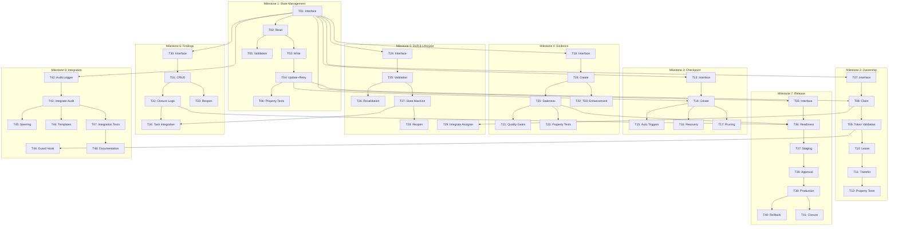

# Implementation Plan: SDLC Workflow Reliability

## Overview

Implementation plan untuk menambahkan reliability, concurrency control, dan release lifecycle ke SDLC Workflow Power. Plan ini mempertahankan backward compatibility dengan komponen multi-developer yang sudah ada.

Implementasi mengikuti TDD methodology dan dibagi ke dalam beberapa milestone berdasarkan dependency dan priority.

## Milestone Summary

| Milestone | Description | Tasks | Priority |
|-----------|-------------|-------|----------|
| M1 | State Management Foundation | T01-T06 | HIGH |
| M2 | Ownership & Concurrency | T07-T12 | HIGH |
| M3 | Checkpoint & Recovery | T13-T17 | HIGH |
| M4 | Evidence & Quality Gates | T18-T23 | HIGH |
| M5 | DoR & Task Lifecycle | T24-T29 | MEDIUM |
| M6 | Review & Findings | T30-T34 | MEDIUM |
| M7 | Release Lifecycle | T35-T41 | HIGH |
| M8 | Integration & Documentation | T42-T48 | LOW |

---

## Tasks

### Milestone 1: State Management Foundation

- [x] T01: Create State_Controller Interface and Types
  - Requirements: R02.1, R02.2, R16.1
  - Files: scripts/state-controller.ts (new)
  - Dependency: None
  - Interface `StateController` dengan semua methods dari design
  - Types untuk `ProjectState`, `StateVersionConflictError`
  - Types untuk state versioning fields

- [x] T02: Implement State_Controller Read Operations
  - Requirements: R02.1, R02.2
  - Files: scripts/state-controller.ts, scripts/__tests__/state-controller.unit.test.ts (new)
  - Dependency: T01
  - `readState()` returns state dan version
  - Version di-parse dari `state_version` field
  - Default version 1 jika field tidak ada (backward compat)
  - Invalid YAML di-handle dengan error yang jelas

- [x] T03: Implement State_Controller Write with Optimistic Concurrency
  - Requirements: R02.2, R02.11
  - Files: scripts/state-controller.ts, scripts/__tests__/state-controller.unit.test.ts
  - Dependency: T02
  - Write succeeds jika expectedVersion match
  - Write fails dengan `StateVersionConflictError` jika mismatch
  - Version di-increment on successful write
  - `last_modified_at` dan `last_modified_by` di-update

- [x] T04: Implement State_Controller updateState with Retry
  - Requirements: R02.2, R02.11
  - Files: scripts/state-controller.ts, scripts/__tests__/state-controller.unit.test.ts
  - Dependency: T03
  - `updateState()` wraps read-modify-write cycle
  - Automatic retry on version conflict
  - Configurable max retries
  - Exponential backoff between retries

- [x] T05: Implement State Consistency Validation
  - Requirements: R16.6
  - Files: scripts/state-controller.ts, scripts/__tests__/state-controller.unit.test.ts
  - Dependency: T02
  - Validate counter totals match sum of by_status
  - Validate reference integrity (task refs exist)
  - Validate required fields present
  - Return structured validation result

- [x] T06: Property Tests for State_Controller
  - Requirements: R02.2
  - Files: scripts/__tests__/state-controller.property.test.ts (new)
  - Dependency: T04
  - Property: Version always monotonically increases
  - Property: Successful write ⇒ version = expected + 1
  - Property: Read after write returns same data

### Milestone 2: Ownership & Concurrency

- [x] T07: Create Ownership_Manager Interface and Types
  - Requirements: R02.3, R02.5, R02.7
  - Files: scripts/ownership-manager.ts (new)
  - Dependency: T01
  - Interface `OwnershipManager` terdefinisi
  - Types untuk `FencingToken`, `LeaseInfo`, `ActorType`
  - Error types untuk ownership errors

- [x] T08: Implement Task Claim with Fencing Token
  - Requirements: R02.3, R02.5, R02.6
  - Files: scripts/ownership-manager.ts, scripts/__tests__/ownership-manager.unit.test.ts (new)
  - Dependency: T07, T04
  - Claim generates unique fencing token (UUID v4)
  - Claim atomic via State_Controller
  - Claim fails if task already has active owner
  - Ownership recorded with timestamp

- [x] T09: Implement Fencing Token Validation
  - Requirements: R02.6
  - Files: scripts/ownership-manager.ts, scripts/__tests__/ownership-manager.unit.test.ts
  - Dependency: T08
  - Valid token → returns true
  - Invalid token → throws error
  - Expired token (for AI agent) → throws error

- [x] T10: Implement Lease Management for AI Agent
  - Requirements: R02.7, R02.8, R02.9
  - Files: scripts/ownership-manager.ts, scripts/__tests__/ownership-manager.unit.test.ts
  - Dependency: T09
  - AI agent claim includes lease info
  - Heartbeat updates `last_heartbeat_at`
  - Lease expires if no heartbeat for 2x interval
  - Expired lease → task marked ABANDONED

- [x] T11: Implement Ownership Transfer
  - Requirements: R02.6, R08.2
  - Files: scripts/ownership-manager.ts, scripts/__tests__/ownership-manager.unit.test.ts
  - Dependency: T10
  - Transfer atomic: old token invalidated, new token issued
  - Transfer requires valid source token
  - Transfer records history
  - Works with Handoff_Coordinator

- [x] T12: Property Tests for Ownership
  - Requirements: R02.3, R02.5, R02.6
  - Files: scripts/__tests__/ownership-manager.property.test.ts (new)
  - Dependency: T11
  - Property: At most one valid fencing token per task
  - Property: Transfer invalidates old token
  - Property: Expired lease → token invalid

### Milestone 3: Checkpoint & Recovery

- [x] T13: Create Checkpoint_Manager Interface and Types
  - Requirements: R09.1, R09.2
  - Files: scripts/checkpoint-manager.ts (new)
  - Dependency: T01
  - Interface `CheckpointManager` terdefinisi
  - Types untuk `Checkpoint`, `CheckpointTrigger`
  - Types untuk `RecoveryPlan`, `RecoveryAction`

- [x] T14: Implement Checkpoint Creation
  - Requirements: R09.1, R09.2
  - Files: scripts/checkpoint-manager.ts, scripts/__tests__/checkpoint-manager.unit.test.ts (new)
  - Dependency: T13, T04
  - Checkpoint captures all required fields
  - Checkpoint saved to `.kiro/sdlc/checkpoints/`
  - Checkpoint ID unique and sequential
  - Git state captured (branch, commit, uncommitted)

- [x] T15: Implement Automatic Checkpoint Triggers
  - Requirements: R09.2
  - Files: scripts/checkpoint-manager.ts
  - Dependency: T14
  - Checkpoint on state transition
  - Checkpoint on TDD phase change
  - Checkpoint on evidence creation
  - Checkpoint on handoff
  - Configurable periodic checkpoint

- [x] T16: Implement Checkpoint Validation and Recovery
  - Requirements: R09.4, R09.5
  - Files: scripts/checkpoint-manager.ts, scripts/__tests__/checkpoint-manager.unit.test.ts
  - Dependency: T14
  - Validate checkpoint vs current repo state
  - Detect stale checkpoints
  - Generate recovery plan dengan discrepancies
  - Execute recovery dengan user confirmation

- [x] T17: Implement Checkpoint Pruning
  - Requirements: R09.7
  - Files: scripts/checkpoint-manager.ts, scripts/__tests__/checkpoint-manager.unit.test.ts
  - Dependency: T14
  - Keep last N checkpoints per task
  - Configurable retention count
  - Prune on checkpoint creation
  - Manual prune command available

### Milestone 4: Evidence & Quality Gates

- [x] T18: Create Evidence_Manager Interface and Types
  - Requirements: R06.1, R06.2
  - Files: scripts/evidence-manager.ts (new)
  - Dependency: T01
  - Interface `EvidenceManager` terdefinisi
  - Types untuk `Evidence`, `EvidenceResult`, `StalenessCheck`
  - Evidence schema terdefinisi

- [x] T19: Implement Evidence Creation with Metadata
  - Requirements: R06.1
  - Files: scripts/evidence-manager.ts, scripts/__tests__/evidence-manager.unit.test.ts (new)
  - Dependency: T18
  - Evidence includes all required fields
  - Git state captured (commit SHA, dirty status)
  - Executor info recorded
  - File hashes for staleness tracking

- [x] T20: Implement Evidence Staleness Detection
  - Requirements: R06.4, R06.5
  - Files: scripts/evidence-manager.ts, scripts/__tests__/evidence-manager.unit.test.ts
  - Dependency: T19
  - Detect when commit SHA differs from HEAD
  - Detect when related files changed
  - Mark evidence as stale with reason
  - Track affected files

- [x] T21: Implement Quality Gate Validation
  - Requirements: R06.7
  - Files: scripts/evidence-manager.ts, scripts/__tests__/evidence-manager.unit.test.ts
  - Dependency: T20
  - Configurable gate requirements
  - Check evidence exists for required gates
  - Check evidence not stale
  - Return gate status (passed/failed)

- [x] T22: Enhance TDD Evidence Validation
  - Requirements: R05.1, R05.2, R05.3, R05.8
  - Files: scripts/evidence-manager.ts
  - Dependency: T19
  - RED: Validate test fails for right reason (BEHAVIOR_MISSING)
  - RED: Detect and reject TEST_ERROR, ENVIRONMENT_ERROR
  - GREEN: Validate same test now passes
  - REFACTOR: Validate no regression

- [x] T23: Property Tests for Evidence
  - Requirements: R06.4, R06.5
  - Files: scripts/__tests__/evidence-manager.property.test.ts (new)
  - Dependency: T20
  - Property: Evidence dengan matching commit = not stale
  - Property: File change after evidence = stale

### Milestone 5: DoR & Task Lifecycle

- [x] T24: Create DoR_Validator Interface and Types
  - Requirements: R01.1, R01.2
  - Files: scripts/dor-validator.ts (new)
  - Dependency: T01
  - Interface `DoRValidator` terdefinisi
  - Types untuk `DoRValidation`, `DoRCondition`
  - All DoR conditions defined

- [x] T25: Implement DoR Validation
  - Requirements: R01.2, R01.3
  - Files: scripts/dor-validator.ts, scripts/__tests__/dor-validator.unit.test.ts (new)
  - Dependency: T24, existing Dependency_Resolver
  - Check AC defined
  - Check blocking deps satisfied
  - Check decisions resolved
  - Check assignee has role
  - Check no blockers

- [x] T26: Implement DoR Revalidation on Changes
  - Requirements: R01.6
  - Files: scripts/dor-validator.ts, scripts/__tests__/dor-validator.unit.test.ts
  - Dependency: T25
  - Dependency completes → revalidate dependent tasks
  - Blocker resolved → revalidate blocked task
  - Decision resolved → revalidate linked tasks

- [x] T27: Enhance Task State Machine
  - Requirements: R04.1, R04.4, R04.5
  - Files: scripts/task-lifecycle.ts (new), scripts/__tests__/task-lifecycle.unit.test.ts (new)
  - Dependency: T25, existing Task_Assigner
  - All states from R04.1 supported
  - BLOCKED as orthogonal attribute
  - HANDOFF_PENDING as orthogonal
  - Transition guards enforced

- [x] T28: Implement Task Reopen with Justification
  - Requirements: R04.7
  - Files: scripts/task-lifecycle.ts, scripts/__tests__/task-lifecycle.unit.test.ts
  - Dependency: T27
  - Reopen requires reason
  - Reopen requires evidence (issue ID, test failure)
  - History recorded
  - Target state configurable

- [x] T29: Integrate Task_Assigner with Ownership_Manager
  - Requirements: R02.3, R02.4
  - Files: scripts/task-assigner.ts (update), scripts/__tests__/task-assigner.unit.test.ts (update)
  - Dependency: T08, existing Task_Assigner
  - assignTask calls claimTask
  - Fencing token returned
  - Existing tests still pass
  - Backward compatible

### Milestone 6: Review & Findings

- [x] T30: Create Finding_Register Interface and Types
  - Requirements: R11.1
  - Files: scripts/finding-register.ts (new)
  - Dependency: T01
  - Interface `FindingRegister` terdefinisi
  - Types untuk `Finding`, `FindingStatus`, `FindingSeverity`
  - Schema matches R11.1

- [x] T31: Implement Finding CRUD Operations
  - Requirements: R11.1
  - Files: scripts/finding-register.ts, scripts/__tests__/finding-register.unit.test.ts (new)
  - Dependency: T30
  - Create finding with all fields
  - Update status with validation
  - Query by task, status, severity
  - Persist to `.kiro/sdlc/findings/`

- [x] T32: Implement Review Closure Logic
  - Requirements: R11.4, R11.5
  - Files: scripts/finding-register.ts, scripts/__tests__/finding-register.unit.test.ts
  - Dependency: T31
  - All CRITICAL resolved → can close
  - All HIGH resolved → can close
  - MEDIUM deferred with approval → can close
  - INFO doesn't block

- [x] T33: Implement Finding Reopen with Evidence
  - Requirements: R11.3
  - Files: scripts/finding-register.ts, scripts/__tests__/finding-register.unit.test.ts
  - Dependency: T31
  - Reopen requires new evidence
  - Creates new finding ID if different issue
  - History preserved
  - Justification required

- [x] T34: Integrate Findings with Task Lifecycle
  - Requirements: R11.5
  - Files: scripts/task-lifecycle.ts (update), scripts/finding-register.ts
  - Dependency: T32, T27
  - Task cannot move to DONE with open CRITICAL/HIGH
  - Blocking findings listed in task
  - Integration dengan DoR check

### Milestone 7: Release Lifecycle

- [x] T35: Create Release_Manager Interface and Types
  - Requirements: R15.1
  - Files: scripts/release-manager.ts (new)
  - Dependency: T01
  - Interface `ReleaseManager` terdefinisi
  - Types untuk semua release states
  - Schema untuk release configuration

- [x] T36: Implement Readiness Check
  - Requirements: R15.2
  - Files: scripts/release-manager.ts, scripts/__tests__/release-manager.unit.test.ts (new)
  - Dependency: T35, T20, T32
  - Check all committed tasks DONE
  - Check evidence valid (not stale)
  - Check no CRITICAL/HIGH findings
  - Generate readiness report

- [x] T37: Implement Staging Deployment Flow
  - Requirements: R15.4
  - Files: scripts/release-manager.ts, scripts/__tests__/release-manager.unit.test.ts
  - Dependency: T36
  - Deploy to staging (record artifact)
  - Run smoke tests
  - Verify health checks
  - Record evidence

- [x] T38: Implement Production Approval Gate
  - Requirements: R15.5
  - Files: scripts/release-manager.ts, scripts/__tests__/release-manager.unit.test.ts
  - Dependency: T37
  - Staging verification required
  - Explicit human approval required
  - Approval recorded with timestamp, approver
  - Rejection returns to staging

- [x] T39: Implement Production Deployment Flow
  - Requirements: R15.6, R15.7
  - Files: scripts/release-manager.ts, scripts/__tests__/release-manager.unit.test.ts
  - Dependency: T38
  - Same artifact as staging deployed
  - Smoke tests run
  - Health checks verified
  - Monitoring period tracked

- [x] T40: Implement Rollback Flow
  - Requirements: R15.7, R15.8
  - Files: scripts/release-manager.ts, scripts/__tests__/release-manager.unit.test.ts
  - Dependency: T39
  - Rollback triggered on failure atau manual
  - Previous version restored
  - Health verified after rollback
  - Incident recorded if applicable

- [x] T41: Implement Release Closure
  - Requirements: R15.10
  - Files: scripts/release-manager.ts, scripts/__tests__/release-manager.unit.test.ts
  - Dependency: T39
  - Close after observation period
  - Record final metrics
  - Archive artifacts
  - Update state to CLOSED

### Milestone 8: Integration & Documentation

- [x] T42: Create Audit_Logger Component
  - Requirements: R16.1, R16.2, R16.3
  - Files: scripts/audit-logger.ts (new), scripts/__tests__/audit-logger.unit.test.ts (new)
  - Dependency: T01
  - Log all actions per R16.2
  - JSONL format
  - Retry on log failure
  - Fallback log if primary fails

- [x] T43: Integrate Audit_Logger with All Components
  - Requirements: R16.2
  - Files: All component files (update)
  - Dependency: T42, M1-M7 components
  - State_Controller logs all writes
  - Ownership changes logged
  - Evidence creation logged
  - Release events logged

- [x] T44: Update SDLC Guard Hook
  - Requirements: R02.6, R02.8
  - Files: scripts/sdlc-guard.js (update)
  - Dependency: T09
  - Validate fencing token
  - Check lease expiry
  - Integration dengan Ownership_Manager

- [x] T45: Update Steering Files
  - Requirements: R17
  - Files: steering/*.md (update)
  - Dependency: All implementation tasks
  - Update 06-implementation.md dengan ownership
  - Update validate.md dengan new validations
  - Update resume.md dengan checkpoint recovery
  - Add release.md enhancements

- [x] T46: Update Templates
  - Requirements: R17
  - Files: templates/*.tmpl (update/new)
  - Dependency: T01, T13, T18, T30
  - project-state.yaml.tmpl updated
  - task.md.tmpl updated
  - New templates untuk checkpoint, evidence, finding

- [x] T47: Write Integration Tests
  - Requirements: All
  - Files: scripts/__tests__/integration/*.test.ts (new)
  - Dependency: All implementation tasks
  - Concurrent claim test
  - Checkpoint recovery test
  - Evidence staleness test
  - Release flow test
  - All 20 test scenarios dari requirements

- [x] T48: Update Documentation
  - Requirements: R17
  - Files: POWER.md (update), README.md (update), TROUBLESHOOTING.md (update), WORKFLOW-DIAGRAMS.md (update)
  - Dependency: All implementation
  - POWER.md updated dengan new features
  - README.md updated dengan new commands
  - TROUBLESHOOTING.md updated dengan new errors
  - WORKFLOW-DIAGRAMS.md updated dengan new diagrams

---

## Task Dependency Graph

## Execution Order

Berikut urutan eksekusi yang direkomendasikan dengan parallel opportunities:

### Wave 1 (Foundation)
- T01: State_Controller Interface

### Wave 2 (Core Interfaces)
- T07: Ownership_Manager Interface (parallel)
- T13: Checkpoint_Manager Interface (parallel)
- T18: Evidence_Manager Interface (parallel)
- T24: DoR_Validator Interface (parallel)
- T30: Finding_Register Interface (parallel)
- T35: Release_Manager Interface (parallel)
- T42: Audit_Logger (parallel)

### Wave 3 (State Read/Write)
- T02: State Read
- T03: State Write (after T02)
- T04: State Update (after T03)
- T05: State Validation (after T02)

### Wave 4 (Ownership Core)
- T06: State Property Tests (after T04)
- T08: Task Claim (after T04, T07)
- T14: Checkpoint Create (after T04, T13)
- T19: Evidence Create (after T18)
- T25: DoR Validation (after T24)
- T31: Finding CRUD (after T30)

### Wave 5 (Advanced Features)
- T09: Token Validation (after T08)
- T15: Auto Triggers (after T14)
- T16: Checkpoint Recovery (after T14)
- T17: Checkpoint Pruning (after T14)
- T20: Staleness Detection (after T19)
- T26: DoR Revalidation (after T25)
- T32: Review Closure (after T31)
- T33: Finding Reopen (after T31)

### Wave 6 (Lease & Integration)
- T10: Lease Management (after T09)
- T21: Quality Gates (after T20)
- T22: TDD Enhancement (after T19)
- T27: Task State Machine (after T25)
- T34: Findings Integration (after T32, T27)

### Wave 7 (Transfer & Release)
- T11: Ownership Transfer (after T10)
- T23: Evidence Property Tests (after T20)
- T28: Task Reopen (after T27)
- T36: Readiness Check (after T35, T20, T32)

### Wave 8 (Complete Ownership)
- T12: Ownership Property Tests (after T11)
- T29: Assigner Integration (after T08)
- T37: Staging Deploy (after T36)

### Wave 9 (Release Flow)
- T38: Production Approval (after T37)
- T39: Production Deploy (after T38)

### Wave 10 (Release Complete)
- T40: Rollback (after T39)
- T41: Release Closure (after T39)

### Wave 11 (Integration)
- T43: Audit Integration (after T42, all components)
- T44: Guard Hook Update (after T09)

### Wave 12 (Documentation)
- T45: Steering Update (after T43)
- T46: Template Update (after components)
- T47: Integration Tests (after all components)
- T48: Documentation (after T47)

---

## Summary Statistics

| Metric | Count |
|--------|-------|
| Total Tasks | 48 |
| Milestones | 8 |
| New Components | 8 |
| Updated Components | 3 |
| New Test Files | ~15 |
| Updated Test Files | ~5 |

### Task Distribution by Milestone

| Milestone | Tasks | Est. Effort |
|-----------|-------|-------------|
| M1: State Management | 6 | Medium |
| M2: Ownership | 6 | Medium |
| M3: Checkpoint | 5 | Medium |
| M4: Evidence | 6 | Medium |
| M5: DoR & Lifecycle | 6 | Medium |
| M6: Findings | 5 | Low |
| M7: Release | 7 | High |
| M8: Integration | 7 | Medium |

---

## Notes

- Setiap task mengikuti TDD cycle: RED → GREEN → REFACTOR → VERIFY
- Property tests untuk critical invariants
- Integration tests cover scenarios dari requirements
- Backward compatibility prioritized di setiap task
- Checkpoints dan validation untuk recovery scenarios

---

## Version History

| Version | Date | Author | Changes |
|---------|------|--------|---------|
| 1.0.0 | 2026-10-12 | Kiro | Initial implementation plan |
| 1.1.0 | 2026-10-12 | Kiro | Reformatted to standard Kiro task format |
