# SDLC Workflow Power - Workflow Diagrams

This document provides visual representations of the SDLC Workflow Power features, including Multi-Developer Support and the new Reliability features.

## Table of Contents

1. [Multi-Developer Support Overview](#multi-developer-support-overview)
2. [Main Workflow Diagram](#1-main-workflow-diagram)
3. [Component Interaction Diagram](#2-component-interaction-diagram)
4. [Task State Machine (Enhanced)](#3-task-state-machine-enhanced)
5. [Ownership State Machine](#4-ownership-state-machine)
6. [Release State Machine](#5-release-state-machine)
7. [TDD Phase Machine (Enhanced)](#6-tdd-phase-machine-enhanced)
8. [Checkpoint Recovery Flow](#7-checkpoint-recovery-flow)
9. [Evidence Staleness Detection](#8-evidence-staleness-detection)
10. [Optimistic Concurrency Flow](#9-optimistic-concurrency-flow)
11. [TDD Cycle Flowchart](#10-tdd-cycle-flowchart)
12. [Parallel Group Execution](#11-parallel-group-execution)
13. [Handoff Process](#12-handoff-process)
14. [Workload Analysis](#13-workload-analysis)
15. [Dependency Resolution Flow](#14-dependency-resolution-flow)
16. [Component Summary](#component-summary)

## Multi-Developer Support Overview

The Multi-Developer Support feature enables coordinated development across multiple team members by providing:

- **Team Management**: Define roles, specializations, and availability for team members
- **Intelligent Task Assignment**: Automatically assign tasks based on skills, workload, and dependencies
- **Dependency Resolution**: Track and resolve task dependencies to prevent blocking
- **Parallel Execution**: Identify and manage tasks that can run concurrently
- **Workload Balancing**: Analyze and optimize work distribution across the team
- **Handoff Coordination**: Manage smooth transitions between developers

## Reliability Features Overview

The Reliability features provide enterprise-grade safety and recoverability:

- **State Versioning**: Optimistic concurrency control prevents lost updates
- **Task Ownership**: Fencing tokens prevent stale writes from old owners
- **Leases & Heartbeats**: Time-limited ownership for AI agents with automatic expiry
- **Checkpoints**: Automatic and manual recovery points
- **Evidence Staleness**: Automatic detection of outdated verification
- **Definition of Ready**: Validation before task can start
- **Finding Register**: Formal tracking of review findings
- **Release Lifecycle**: Full deployment workflow with rollback support
- **Audit Logging**: Complete operation trail

---

## 1. Main Workflow Diagram

The overall flow from project initialization to completion:

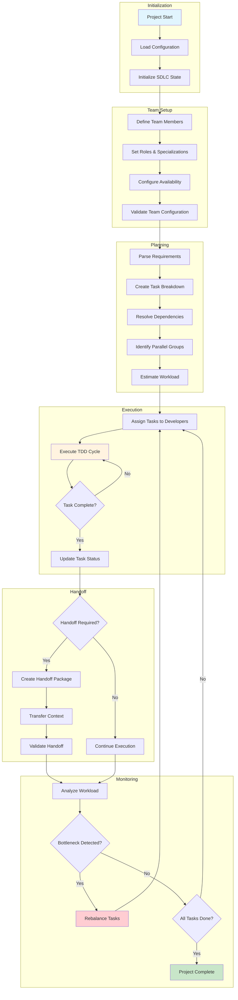

---

## 2. Component Interaction Diagram

How all components (existing and new) interact with each other:

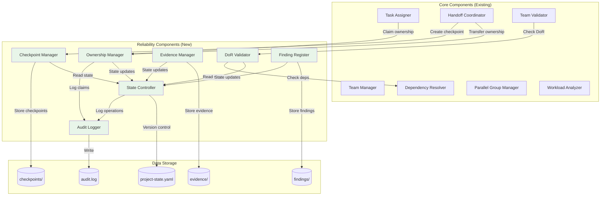

---

## 3. Task State Machine (Enhanced)

The complete task lifecycle with all states and orthogonal attributes:

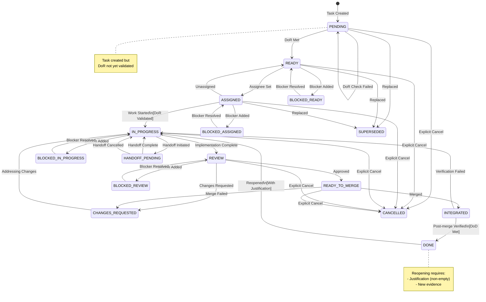

### Orthogonal Attributes

These attributes can be applied independently of the main state:

| Attribute | Description | Applies To |
|-----------|-------------|------------|
| `blocked: true/false` | Task has active blockers | PENDING, READY, ASSIGNED, IN_PROGRESS, REVIEW |
| `blocked_reason` | Why task is blocked | When blocked=true |
| `blocker_refs` | BLOCKER-xxx references | When blocked=true |
| `handoff_pending: true/false` | Handoff in progress | IN_PROGRESS |
| `handoff_id` | HO-xxx reference | When handoff_pending=true |

---

## 4. Ownership State Machine

Ownership lifecycle for AI agents with lease management:

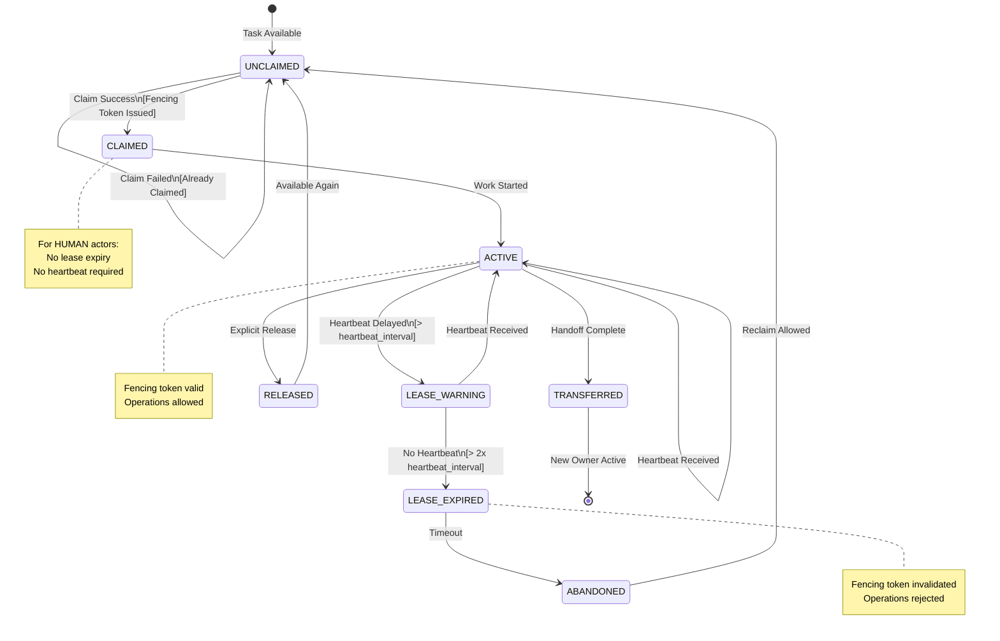

### Ownership Differences: Human vs AI Agent

| Aspect | Human | AI Agent |
|--------|-------|----------|
| Lease Duration | Unlimited | Configurable (default: 1 hour) |
| Heartbeat | Not required | Required every 5 minutes |
| Auto-expiry | No | Yes, after 2x heartbeat interval |
| Inactivity | Warning only | Lease expiration |
| Fencing Token | Yes | Yes |

---

## 5. Release State Machine

Complete release lifecycle from planning to production:

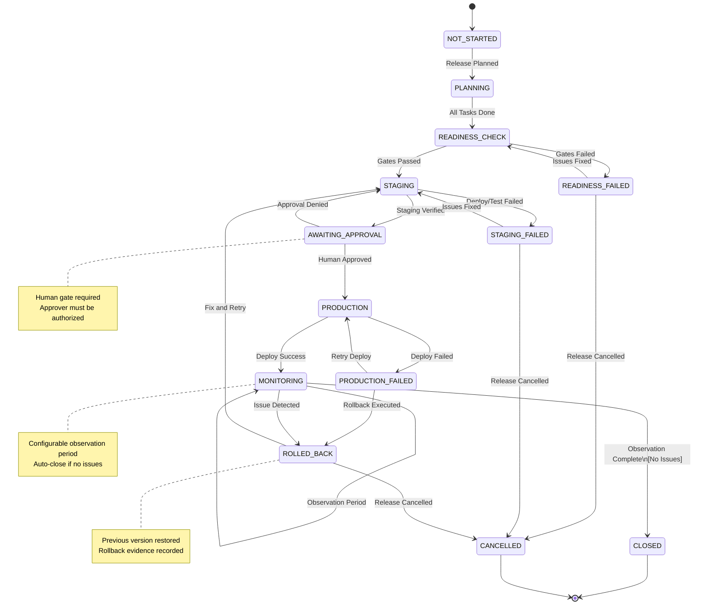

### Release Stages

| Stage | Description | Requirements |
|-------|-------------|--------------|
| NOT_STARTED | Initial state | - |
| PLANNING | Release being planned | Version defined |
| READINESS_CHECK | Quality gates evaluation | All tasks DONE |
| STAGING | Deployed to staging | Readiness passed |
| AWAITING_APPROVAL | Waiting for human approval | Staging verified |
| PRODUCTION | Deployed to production | Human approved |
| MONITORING | Post-deploy observation | Production verified |
| CLOSED | Release complete | Observation passed |
| CANCELLED | Release cancelled | Explicit cancel |
| ROLLED_BACK | Reverted to previous | Rollback executed |

---

## 6. TDD Phase Machine (Enhanced)

TDD cycle with enhanced error handling and evidence types:

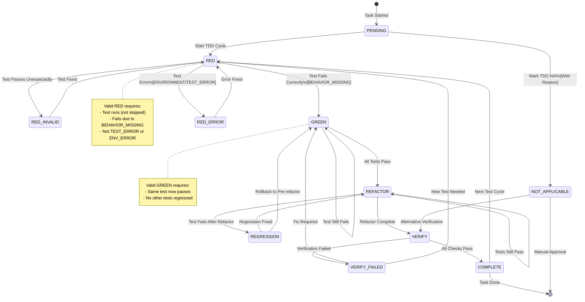

### Test Error Categories

| Category | Description | Action |
|----------|-------------|--------|
| BEHAVIOR_MISSING | Expected failure, behavior not implemented | Valid RED, proceed to GREEN |
| TEST_ERROR | Test code has bugs (syntax, assertion error) | Fix test before proceeding |
| ENVIRONMENT_ERROR | Runtime, connection, config issue | Fix environment |
| SKIPPED | Test not executed | Invalid evidence, ensure test runs |

---

## 7. Checkpoint Recovery Flow

How checkpoints are created and used for recovery:

```mermaid
flowchart TD
    subgraph Creation["Checkpoint Creation"]
        T1[State Transition] -->|Auto| CREATE
        T2[TDD Phase Change] -->|Auto| CREATE
        T3[Evidence Created] -->|Auto| CREATE
        T4[Handoff Event] -->|Auto| CREATE
        T5[Periodic Timer] -->|Auto| CREATE
        T6[User Request] -->|Manual| CREATE
        
        CREATE[Create Checkpoint] --> CAPTURE
        CAPTURE[Capture Snapshot]
        
        subgraph Snapshot["Snapshot Contents"]
            S1[state_version]
            S2[task_id & status]
            S3[owner_id & fencing_token]
            S4[tdd_phase]
            S5[branch_name & commit_sha]
            S6[uncommitted_changes]
            S7[evidence_refs]
            S8[blockers]
            S9[next_action]
        end
        
        CAPTURE --> S1 & S2 & S3 & S4 & S5 & S6 & S7 & S8 & S9
        S1 & S2 & S3 & S4 & S5 & S6 & S7 & S8 & S9 --> STORE
        STORE[Store to checkpoints/]
    end
    
    subgraph Recovery["Checkpoint Recovery"]
        R1[Resume Request] --> LIST
        LIST[List Checkpoints] --> SELECT
        SELECT[Select Checkpoint] --> VALIDATE
        
        VALIDATE{Validate Against\nCurrent State}
        
        VALIDATE -->|Branch exists?| CHECK_BRANCH
        VALIDATE -->|Commit reachable?| CHECK_COMMIT
        VALIDATE -->|State version?| CHECK_VERSION
        
        CHECK_BRANCH -->|No| DISCREP[Add Discrepancy]
        CHECK_COMMIT -->|No| DISCREP
        CHECK_VERSION -->|Newer exists| DISCREP
        
        DISCREP --> STRATEGY
        
        CHECK_BRANCH -->|Yes| PREPARE
        CHECK_COMMIT -->|Yes| PREPARE
        CHECK_VERSION -->|Match| PREPARE
        
        PREPARE[Prepare Recovery Plan]
        STRATEGY{Determine Strategy}
        
        STRATEGY -->|Compatible| AUTO[AUTO_MERGE]
        STRATEGY -->|Conflicts| PROMPT[PROMPT_USER]
        STRATEGY -->|Too stale| REJECT[REJECT]
        
        AUTO --> EXECUTE
        PROMPT --> USER_CONFIRM{User Confirms?}
        USER_CONFIRM -->|Yes| EXECUTE
        USER_CONFIRM -->|No| ABORT[Abort Recovery]
        REJECT --> ABORT
        
        EXECUTE[Execute Recovery]
        EXECUTE --> RESTORED[State Restored]
    end

    style Creation fill:#e3f2fd
    style Recovery fill:#e8f5e9
    style Snapshot fill:#fff8e1
```

### Recovery Strategies

| Strategy | Condition | Behavior |
|----------|-----------|----------|
| AUTO_MERGE | Changes are compatible | Automatically reconcile differences |
| PROMPT_USER | Conflicts or ambiguous | User decides how to proceed |
| REJECT | Checkpoint too stale | Require fresh start or different checkpoint |

---

## 8. Evidence Staleness Detection

How evidence freshness is tracked and validated:

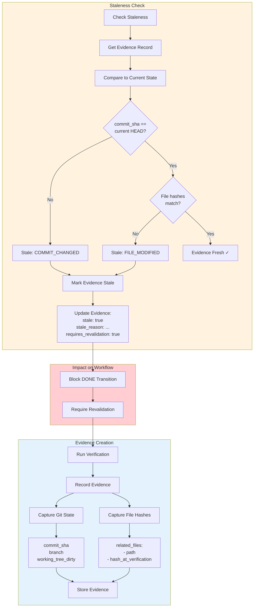

### Staleness Reasons

| Reason | Description | Resolution |
|--------|-------------|------------|
| COMMIT_CHANGED | Current commit differs from evidence commit | Re-run verification |
| FILE_MODIFIED | Related files changed after verification | Re-run verification |
| CONFIG_CHANGED | Test configuration changed | Re-run verification |

---

## 9. Optimistic Concurrency Flow

How state updates are protected against concurrent modifications:

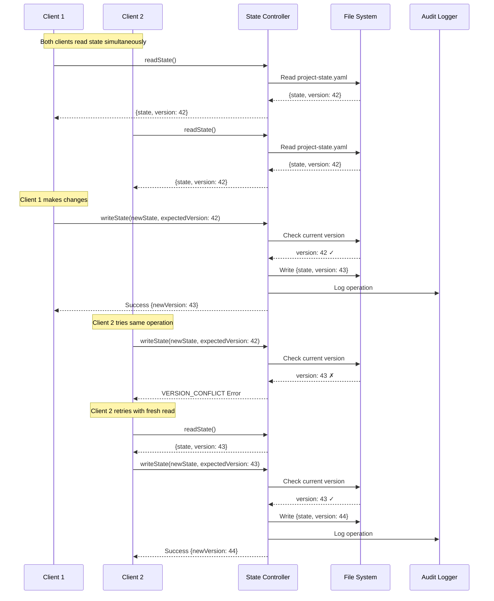

### Retry with Exponential Backoff

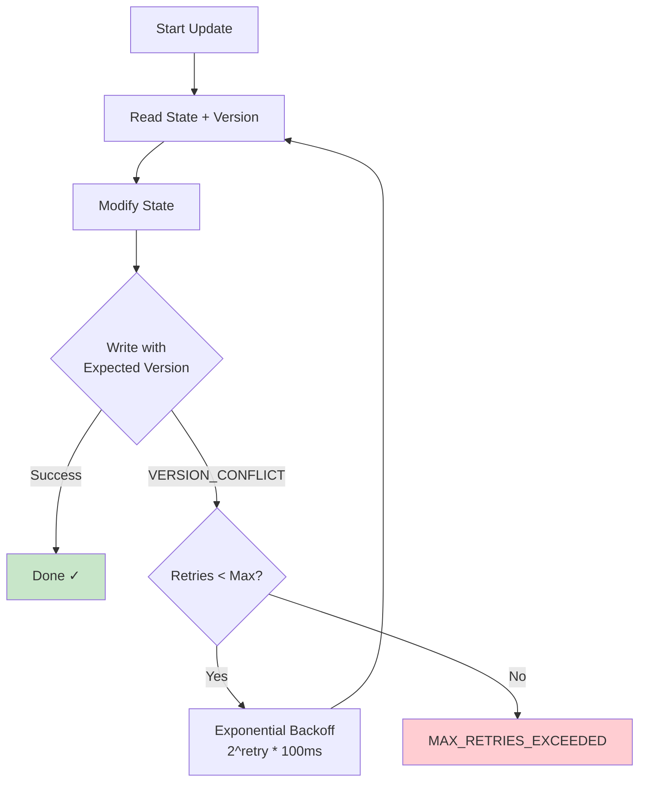

---

Detailed view of the Test-Driven Development cycle:

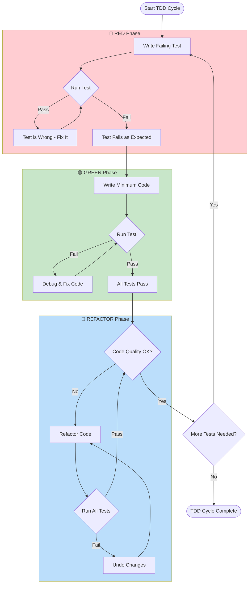

---

## 11. Parallel Group Execution

Visualization of how tasks execute in parallel groups:

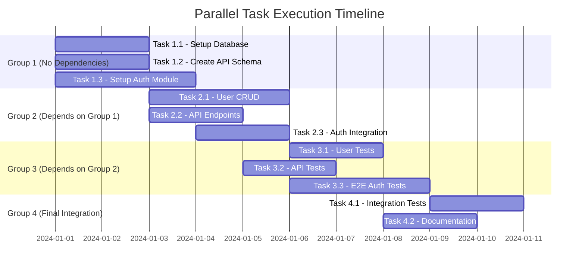

---

## 12. Handoff Process

Communication flow during developer handoff (enhanced with ownership transfer):

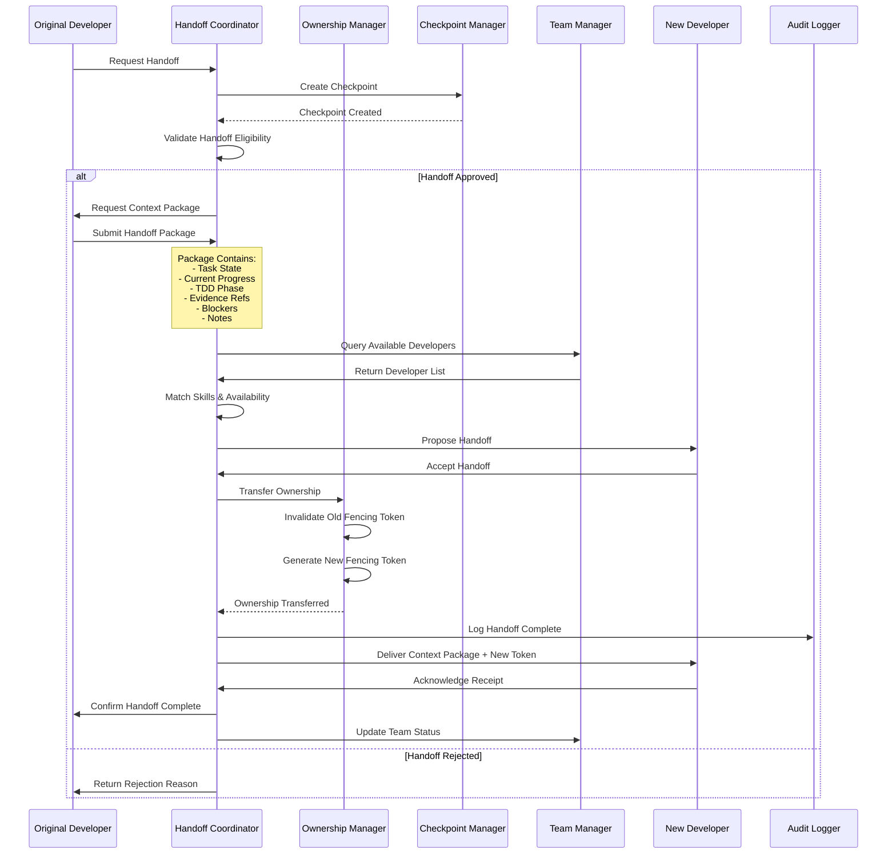

---

## 13. Workload Analysis

How the Workload Analyzer evaluates and balances work:

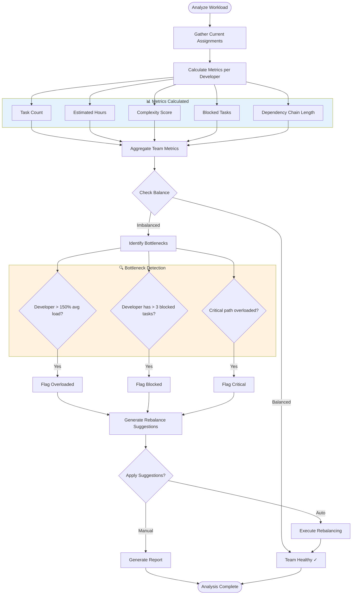

---

## 14. Dependency Resolution Flow

How dependencies are tracked and resolved:

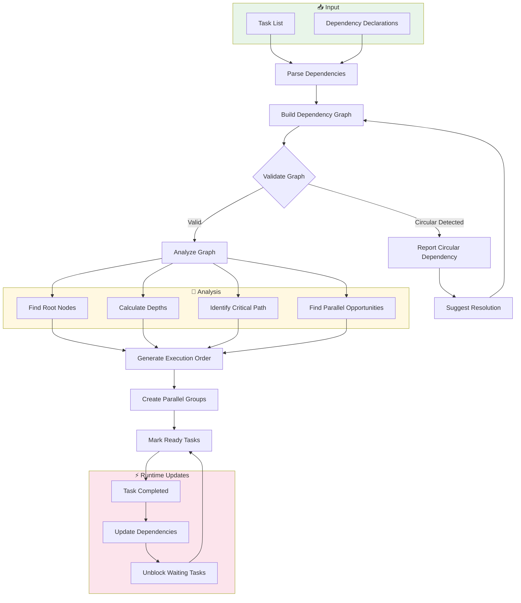

---

## 15. Quick Reference Commands

| Command | Description | Component |
|---------|-------------|-----------|
| `team:add <name> <role>` | Add a new team member | Team Manager |
| `team:remove <name>` | Remove a team member | Team Manager |
| `team:status` | View team overview | Team Manager |
| `task:assign <task> <dev>` | Manually assign task | Task Assigner |
| `task:auto-assign` | Auto-assign all pending tasks | Task Assigner |
| `task:claim <task>` | Claim ownership with fencing token | Ownership Manager |
| `task:release` | Release task ownership | Ownership Manager |
| `task:heartbeat` | Record AI agent heartbeat | Ownership Manager |
| `dep:check <task>` | Check task dependencies | Dependency Resolver |
| `dep:graph` | Display dependency graph | Dependency Resolver |
| `parallel:groups` | Show parallel execution groups | Parallel Group Manager |
| `parallel:optimize` | Optimize group assignments | Parallel Group Manager |
| `workload:analyze` | Run workload analysis | Workload Analyzer |
| `workload:rebalance` | Suggest rebalancing | Workload Analyzer |
| `handoff:request <task>` | Request task handoff | Handoff Coordinator |
| `handoff:status` | View pending handoffs | Handoff Coordinator |
| `checkpoint:create` | Create manual checkpoint | Checkpoint Manager |
| `checkpoint:list` | List available checkpoints | Checkpoint Manager |
| `checkpoint:recover <id>` | Prepare recovery plan | Checkpoint Manager |
| `evidence:check <id>` | Check evidence staleness | Evidence Manager |
| `evidence:list <task>` | List evidence for task | Evidence Manager |
| `release:plan <version>` | Plan a new release | Release Manager |
| `release:check` | Run readiness check | Release Manager |
| `release:stage` | Deploy to staging | Release Manager |
| `release:approve` | Record production approval | Release Manager |
| `release:deploy` | Deploy to production | Release Manager |
| `release:rollback` | Rollback release | Release Manager |
| `finding:create` | Create review finding | Finding Register |
| `finding:update <id>` | Update finding status | Finding Register |
| `finding:list` | List findings | Finding Register |

---

## 16. Bottleneck Detection Rules

| Rule | Threshold | Action | Priority |
|------|-----------|--------|----------|
| Overloaded Developer | > 150% average workload | Suggest task redistribution | High |
| Blocked Task Accumulation | > 3 blocked tasks per dev | Review dependency chain | High |
| Critical Path Concentration | > 50% critical tasks on one dev | Distribute critical work | Critical |
| Idle Developer | < 25% average workload | Assign more tasks | Medium |
| Long Dependency Chain | > 5 sequential dependencies | Identify parallelization | Medium |
| Stale Task | No progress > 2 days | Check for blockers | High |
| Handoff Pending | > 24 hours unacknowledged | Escalate handoff | Medium |
| Skill Mismatch | Task complexity > dev experience | Suggest pair programming | Low |
| Expired Lease | AI agent lease timeout | Mark task abandoned | High |
| Stale Evidence | Evidence older than HEAD | Block task completion | High |
| Unresolved Findings | CRITICAL/HIGH open | Block release | Critical |

---

## 17. Definition of Ready Flow

How Definition of Ready is validated before task can start:

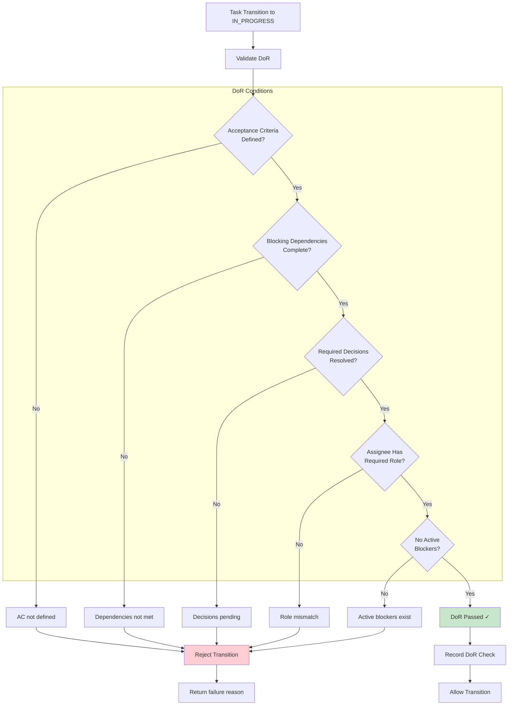

---

## 18. Finding Lifecycle

How review findings are tracked and resolved:

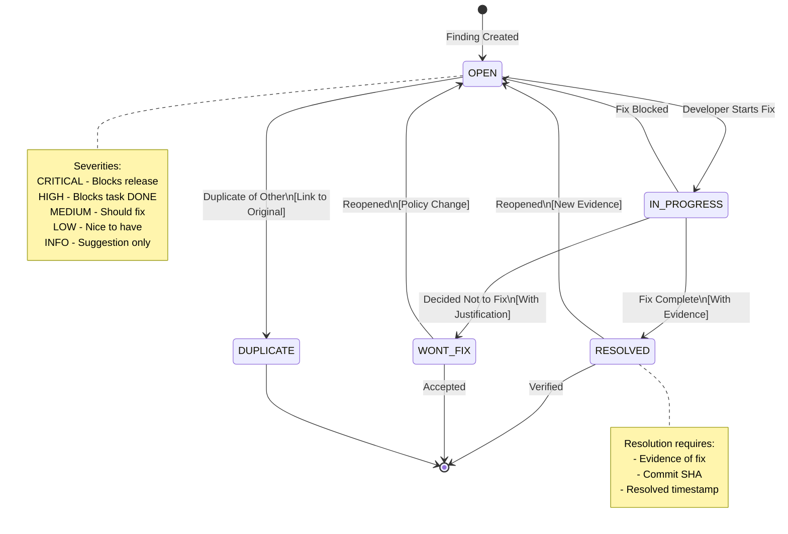

### Finding Severity Impact

| Severity | Blocks Task DONE | Blocks Release | Required Response |
|----------|------------------|----------------|-------------------|
| CRITICAL | Yes | Yes | Immediate fix |
| HIGH | Yes | Yes | Fix before done |
| MEDIUM | With justification | No | Should fix |
| LOW | No | No | Can defer |
| INFO | No | No | No action required |

---

## Component Summary

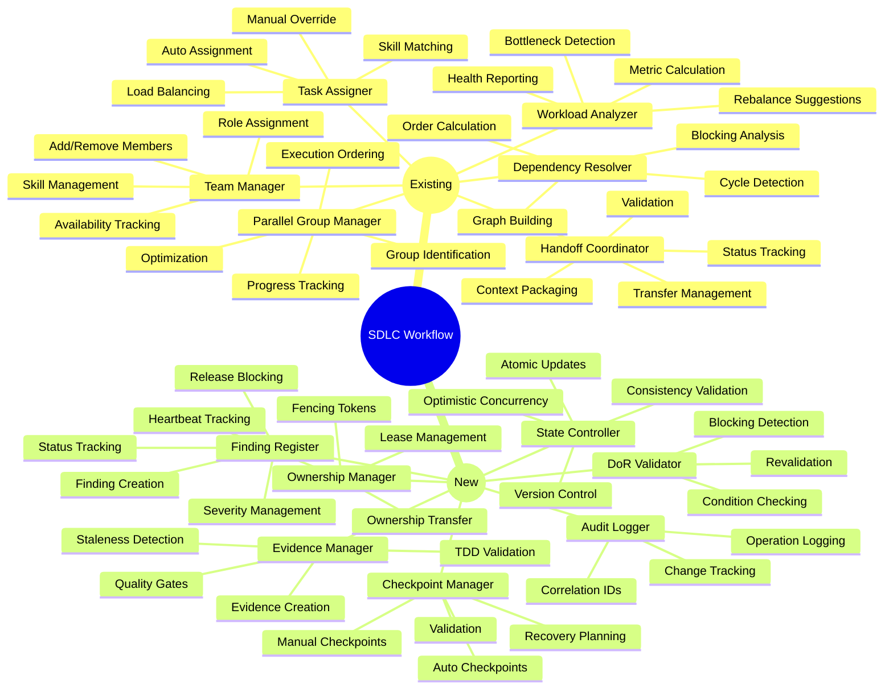

---

## See Also

- [POWER.md](./POWER.md) - Main power documentation
- [README.md](./README.md) - Getting started guide
- [TROUBLESHOOTING.md](./TROUBLESHOOTING.md) - Common issues and solutions
