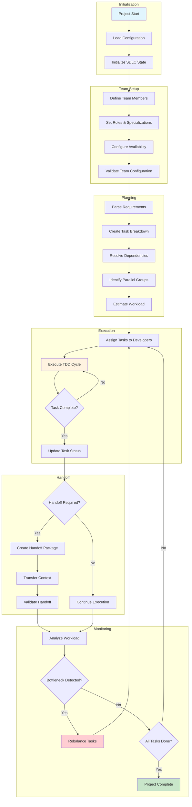
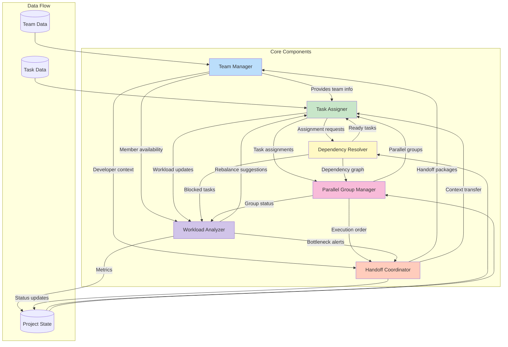
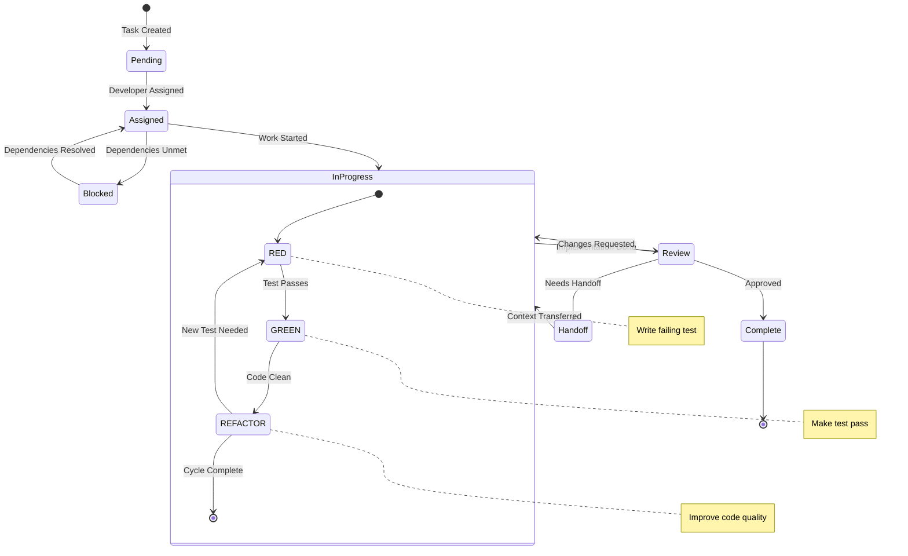
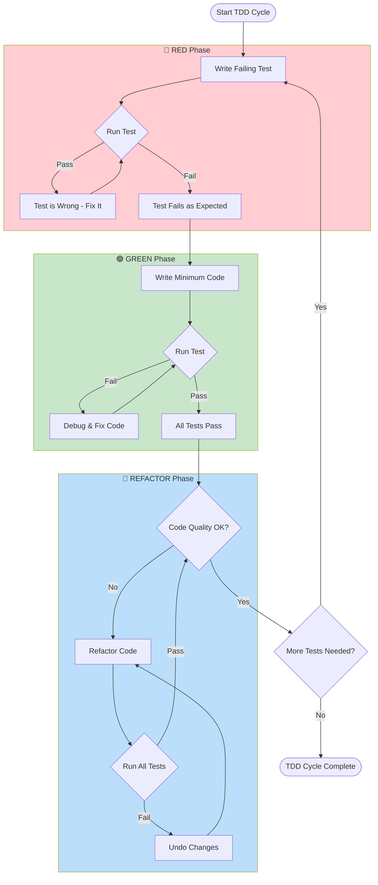
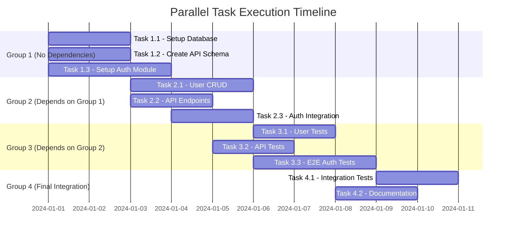
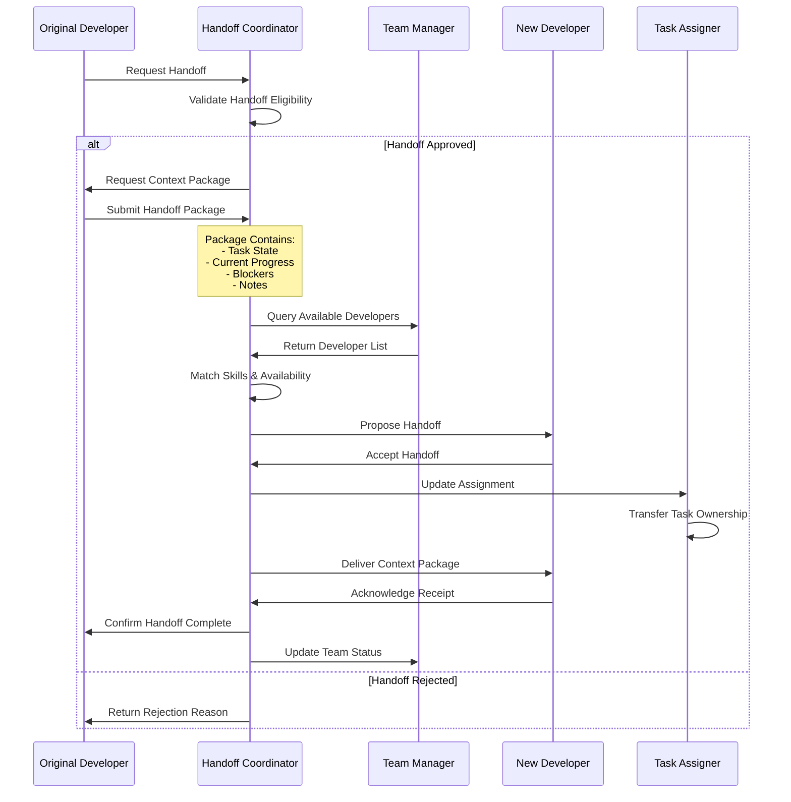
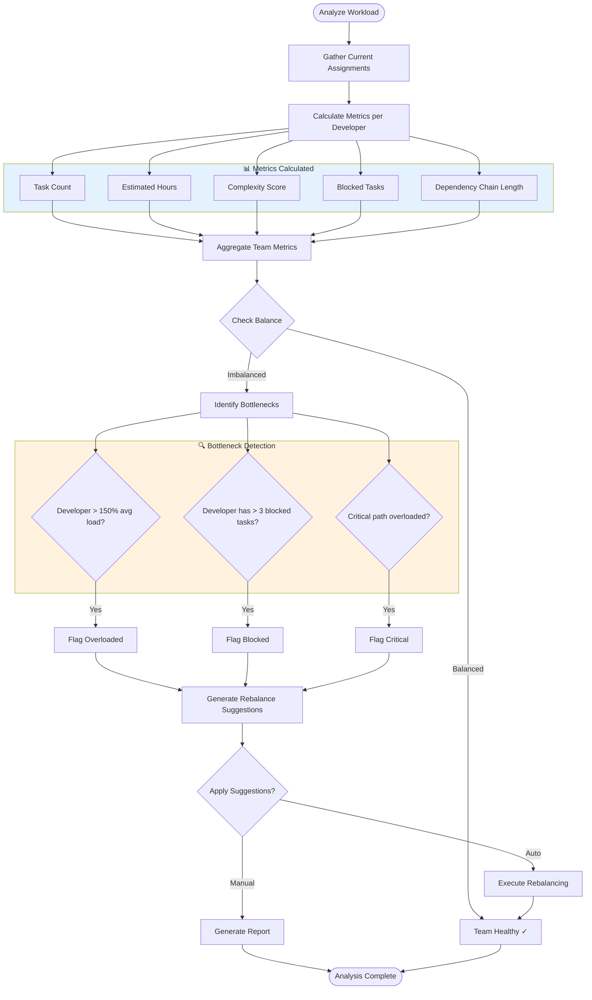
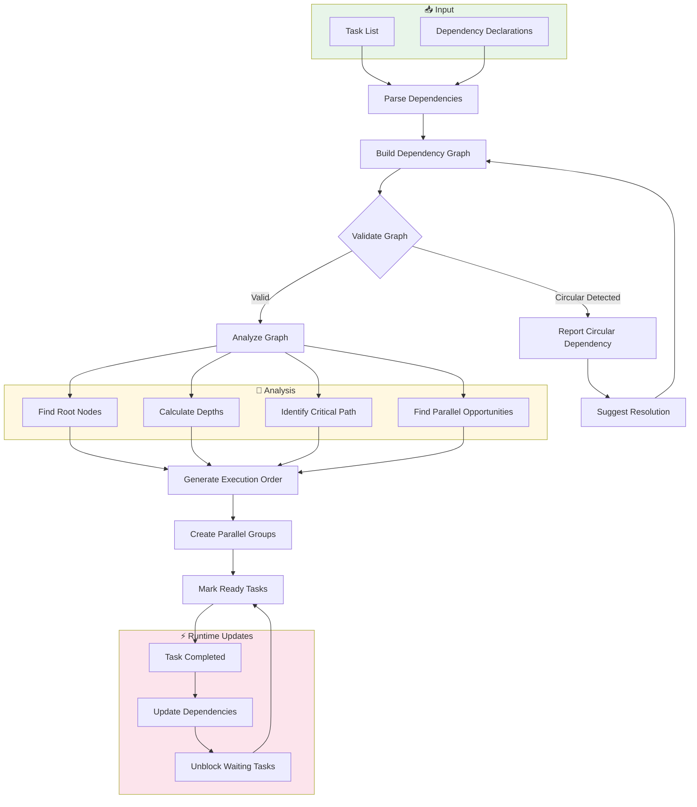
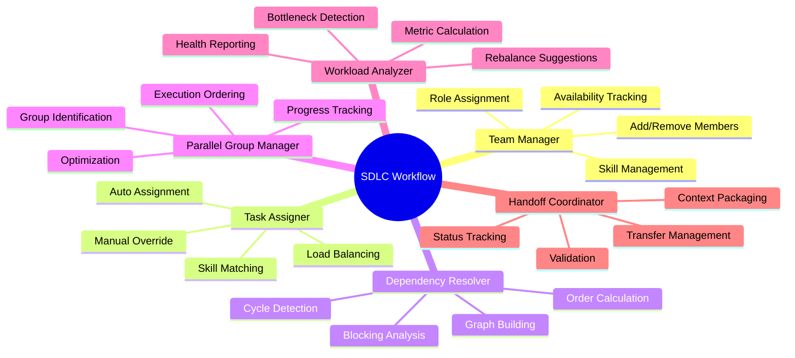

# SDLC Workflow Power - Workflow Diagrams

This document provides visual representations of the Multi-Developer Support feature workflows, component interactions, and processes within the SDLC Workflow Power.

## Multi-Developer Support Overview

The Multi-Developer Support feature enables coordinated development across multiple team members by providing:

- **Team Management**: Define roles, specializations, and availability for team members
- **Intelligent Task Assignment**: Automatically assign tasks based on skills, workload, and dependencies
- **Dependency Resolution**: Track and resolve task dependencies to prevent blocking
- **Parallel Execution**: Identify and manage tasks that can run concurrently
- **Workload Balancing**: Analyze and optimize work distribution across the team
- **Handoff Coordination**: Manage smooth transitions between developers

---

## 1. Main Workflow Diagram

The overall flow from project initialization to completion:

---

## 2. Component Interaction Diagram

How the six core components interact with each other:

---

## 3. Task Lifecycle State Diagram

The states a task goes through during development with TDD phases:

---

## 4. TDD Cycle Flowchart

Detailed view of the Test-Driven Development cycle:

---

## 5. Parallel Group Execution - Gantt Chart Example

Visualization of how tasks execute in parallel groups:

---

## 6. Handoff Process Sequence Diagram

Communication flow during developer handoff:

---

## 7. Workload Analysis Flowchart

How the Workload Analyzer evaluates and balances work:

---

## 8. Dependency Resolution Flow

How dependencies are tracked and resolved:

---

## 9. Quick Reference Commands

| Command | Description | Component |
|---------|-------------|-----------|
| `team:add <name> <role>` | Add a new team member | Team Manager |
| `team:remove <name>` | Remove a team member | Team Manager |
| `team:status` | View team overview | Team Manager |
| `task:assign <task> <dev>` | Manually assign task | Task Assigner |
| `task:auto-assign` | Auto-assign all pending tasks | Task Assigner |
| `dep:check <task>` | Check task dependencies | Dependency Resolver |
| `dep:graph` | Display dependency graph | Dependency Resolver |
| `parallel:groups` | Show parallel execution groups | Parallel Group Manager |
| `parallel:optimize` | Optimize group assignments | Parallel Group Manager |
| `workload:analyze` | Run workload analysis | Workload Analyzer |
| `workload:rebalance` | Suggest rebalancing | Workload Analyzer |
| `handoff:request <task>` | Request task handoff | Handoff Coordinator |
| `handoff:status` | View pending handoffs | Handoff Coordinator |

---

## 10. Bottleneck Detection Rules

| Rule | Threshold | Action | Priority |
|------|-----------|--------|----------|
| Overloaded Developer | > 150% average workload | Suggest task redistribution | High |
| Blocked Task Accumulation | > 3 blocked tasks per dev | Review dependency chain | High |
| Critical Path Concentration | > 50% critical tasks on one dev | Distribute critical work | Critical |
| Idle Developer | < 25% average workload | Assign more tasks | Medium |
| Long Dependency Chain | > 5 sequential dependencies | Identify parallelization | Medium |
| Stale Task | No progress > 2 days | Check for blockers | High |
| Handoff Pending | > 24 hours unacknowledged | Escalate handoff | Medium |
| Skill Mismatch | Task complexity > dev experience | Suggest pair programming | Low |

---

## Component Summary

---

## See Also

- [POWER.md](./POWER.md) - Main power documentation
- [README.md](./README.md) - Getting started guide
- [TROUBLESHOOTING.md](./TROUBLESHOOTING.md) - Common issues and solutions
